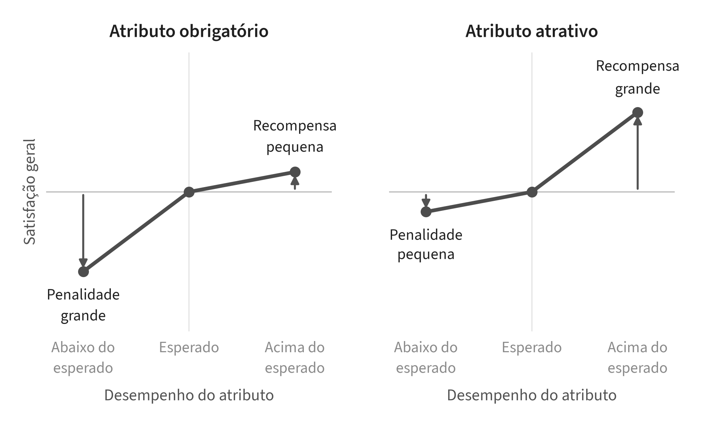

# 2 REFERENCIAL TEÓRICO

O plano de negócios é uma ferramenta de gestão que descreve um empreendimento e delineia sua estratégia de atuação futura. No âmbito de novos empreendimentos, ele serve para testar a viabilidade econômico-financeira do projeto, comunicar valor para investidores e sócios em potencial, e, de modo geral, reduzir o risco de abrir o negócio (DORNELAS, 2021, p. 4, 7). No Brasil, 25,8% das micro e pequenas empresas fecham nos primeiros cinco anos – 25,9% no setor de serviços (SEBRAE, 2024). Em um segmento recente e com pouca informação de mercado, como o das luderias, o plano precisa declarar quais premissas são incertas e como mitigar tais incertezas antes de investir todo o capital.

Antes da elaboração do plano, Dornelas (2021, p. 21) propõe que a ideia passe por um roteiro de análise de oportunidade, os 3M: demanda de mercado, tamanho e estrutura do mercado e análise de margem. A demanda trata do público-alvo, do acesso aos clientes e do crescimento do mercado. O tamanho e a estrutura tratam do tamanho do mercado, do número de concorrentes, da fragmentação do mercado e das barreiras de entrada. A margem trata dos lucros possíveis, dos custos, do ponto de equilíbrio e do retorno do capital. Os três critérios organizam este plano: a estrutura do mercado é analisada no capítulo 5, a demanda é estimada no capítulo 6 e a margem é calculada no capítulo 9.

## 2.1 A ECONOMIA DA EXPERIÊNCIA

Pagar para viver um momento em grupo é um hábito antigo. Pine e Gilmore (1998 *apud* FITZSIMMONS; FITZSIMMONS, 2014) deram nome a esse hábito ao tratar a experiência como uma oferta econômica própria, distinta de bens e de serviços – a empresa encena um acontecimento memorável, e o cliente paga pelo tempo que passa nele. A luderia é uma oferta desse tipo. Ela vende uma ocasião social, e não o uso de um jogo – o jogo é o meio, e o produto é o encontro e a interação em torno da mesa. Essa distinção orienta a proposta de valor e a leitura das ocasiões de consumo.

De acordo com Fitzsimmons e Fitzsimmons (2014), a experiência é o estágio mais recente da evolução econômica, depois da agricultura, da indústria e dos serviços. A oferta passa a ser encenada e memorável, e o cliente é tratado como convidado. As experiências variam conforme a participação do cliente – passiva ou ativa – e a relação com o ambiente – de absorção ou de imersão. O cruzamento dessas dimensões forma quatro esferas: entretenimento, educação, dimensão estética e aventura (PINE; GILMORE, 1998 *apud* FITZSIMMONS; FITZSIMMONS, 2014). Os jogos de tabuleiro exigem participação ativa por parte dos jogadores e proporcionam uma relação de imersão durante as partidas, aproximando-os da esfera da aventura. Dessa forma, a luderia se distingue do entretenimento passivo, como shows e cinema, concorrendo com esses serviços apenas de forma indireta, pelo tempo livre do cliente.

A luderia pertence ao segmento de *competitive socialising*: locais de lazer em que grupos se reúnem em torno de um jogo ou de uma atividade competitiva – como minigolfe, boliche, salas de fuga e realidade virtual –, em geral acompanhada de comida e bebida (KAM INSIGHT, 2022, p. 8). O formato também pode assumir uma função social: o arranjo do ambiente do serviço pode estimular a interação entre clientes, como em mesas compartilhadas ou eventos de competição (FITZSIMMONS; FITZSIMMONS, 2014, p. 154). A luderia disputa esse lugar de convívio na rotina do cliente.

## 2.2 ANÁLISE ESTRATÉGICA

Definido o produto, passa-se à análise do ambiente em que ele compete. De maneira direta, os fatores que mais influem na rentabilidade de um setor são os que compõem o chamado ambiente setorial. O modelo de Porter destrincha tais fatores em cinco forças: a rivalidade entre os concorrentes, a ameaça de novos entrantes, a ameaça de substitutos, o poder de negociação dos compradores e o poder de negociação dos fornecedores (PORTER, 2004, [AV]). No caso das luderias, os substitutos são bares, restaurantes e outras formas de lazer noturno, e os fornecedores críticos são as editoras de jogos e os de alimentos e bebidas. Além da estrutura do setor, o negócio também responde a um ambiente mais amplo, denominado de macroambiente, que reúne as forças externas que a empresa não controla (KOTLER; KELLER, 2013, p. 10). A análise PESTEL organiza as forças desse ambiente em seis dimensões: política, econômica, social, tecnológica, ambiental e legal.

O diagnóstico estratégico junta as análises do setor e do macroambiente às características internas do negócio. A análise SWOT organiza esse diagnóstico numa matriz que cruza as forças e fraquezas do negócio com as oportunidades e ameaças do ambiente (KOTLER; KELLER, 2013, p. 49). O cruzamento dos quadrantes indica a estratégia.

## 2.3 ATRIBUTOS DE SATISFAÇÃO <<>>

O modelo Kano classifica os atributos de um serviço pela relação entre desempenho e satisfação. Atributos obrigatórios geram insatisfação quando ausentes, mas não geram satisfação quando presentes; atributos atrativos geram satisfação quando presentes, sem gerar insatisfação quando ausentes (PICOLO; TONTINI, 2008, p. 40).

Para aplicar o modelo, é preciso medir essa relação em clientes reais. A análise do contraste da penalidade e da recompensa (PRC) faz essa classificação a partir de dados de satisfação. Para cada atributo, a PRC compara dois casos: o desempenho abaixo do esperado e o desempenho acima do esperado. O coeficiente de penalidade mede quanto a satisfação geral cai nos casos de desempenho abaixo do esperado. O coeficiente de recompensa mede quanto a satisfação geral sobe nos casos de desempenho acima do esperado. Os dois coeficientes saem de uma regressão da satisfação geral sobre esses indicadores (PICOLO; TONTINI, 2008, p. 42). Atributo com penalidade maior que a recompensa é obrigatório; atributo com recompensa maior que a penalidade, atrativo (PICOLO; TONTINI, 2008, p. 51). A Figura 2.1 ilustra os dois perfis. Assim, os atributos obrigatórios indicam onde o negócio não pode cortar recursos, enquanto os atrativos indicam onde ele pode buscar diferenciação.

**Figura 2.1 – Penalidade e recompensa na análise PRC**

Fonte: elaborado pelo próprio autor, com base em Picolo e Tontini (2008).

A PRC, no entanto, tem um limite: ela só permite identifica atributos que o cliente já experimentou; atributos inovadores tendem a aparecer como não significativos (PICOLO; TONTINI, 2008, p. 56). Por isso, a PRC apoia apenas as decisões de reduzir ou ampliar atributos já consolidados. A inclusão de atributos novos se apoia em outra evidência, como a oferta das luderias de outras metrópoles.

## 2.4 VIABILIDADE E DECISÃO SOB INCERTEZA

Para decidir se um projeto vale o investimento, a análise de viabilidade compara o dinheiro que ele exige hoje com o que ele devolve no futuro. Como um real hoje vale mais do que um real daqui a cinco anos, os valores futuros são trazidos para o presente por uma taxa de desconto, a taxa mínima de atratividade (TMA) – o retorno mínimo que o investidor aceita, dado o que ganharia em outra aplicação de risco parecido. Três indicadores resumem essa comparação. O valor presente líquido (VPL) é a soma dos fluxos de caixa futuros descontados pela TMA, menos o investimento inicial (BRUNI, 2018, p. 227). VPL positivo indica que o projeto devolve mais do que a TMA exige, ou seja, cria valor para o investidor. A taxa interna de retorno (TIR) é a taxa que torna o VPL igual a zero – o retorno anual que o próprio projeto entrega –, e o projeto é aceito quando a TIR supera a TMA (BRUNI, 2018, p. 260, 262). O payback descontado é o prazo em que os fluxos descontados recuperam o investimento (BRUNI, 2018, p. 220) e mostra por quanto tempo o capital fica exposto ao risco.

A escolha da TMA, portanto, decide boa parte do resultado. Ela parte de uma taxa livre de risco e soma um prêmio pelo risco do projeto (BRUNI, 2018, p. 158, 177). Um negócio de capital fechado, sem liquidez, soma a esse prêmio um prêmio de liquidez, que remunera a dificuldade de vender o investimento por um valor justo (ASSAF NETO, 2014, p. 89). Em termos simples, a TMA começa no que o investidor ganharia sem risco, como num título público, e sobe por dois motivos: o negócio pode dar errado, e a participação numa luderia não se vende com a facilidade de uma ação na bolsa. Quanto maior a TMA, mais o projeto precisa render para ser aceito.

Os três indicadores respondem se o projeto vale o investimento; o ponto de equilíbrio responde quranto o negócio precisa vender. Ele é o volume de vendas em que a receita cobre os custos fixos e variáveis (BRUNI, 2018, p. 203). Na luderia, ele se expressa em visitantes por semana e pode ser comparado com o fluxo estimado. Se o fluxo fica abaixo dele, a operação não se paga.

O fluxo estimado também precisa caber no salão. O serviço depende da capacidade, que é perecível – a mesa vazia em uma hora não pode ser vendida na hora seguinte. Para evitar perdas por falta ou excesso de espaço, a lei de Little liga as medidas de ocupação: o número médio de clientes no estabelecimento é igual à taxa de chegada multiplicada pela permanência média (FITZSIMMONS; FITZSIMMONS, 2014, p. 406).

A qualidade de um plano de negócios depende, em grande parte, da qualidade das premissas adotadas. Por isso, o plano segue a gestão baseada em evidências: as decisões usam as melhores evidências disponíveis, e não o costume, a imitação de casos de sucesso ou a crença não testada (PFEFFER; SUTTON, 2006, [AV]). Quando as evidências são insuficientes, as premissas partem das evidências disponíveis e são testadas em pequena escala antes da decisão definitiva (PFEFFER; SUTTON, 2006, [AV]). Nas análises de cenário, as premissas de maior incerteza recebem três valores – pessimista, provável e otimista –, e o modelo financeiro é calculado com cada conjunto. O resultado é uma faixa de VPL, TIR e payback, em vez de um número único, que mostra sob quais condições o negócio se sustenta. Para além das análises, há ainda validações que podem ser realizadas antes do investimento integral.

O único estudo de viabilidade localizado sobre o formato, de um *board game café* em Ourinhos (SP), declara o negócio viável pelo payback simples e não testa a sensibilidade às premissas de receita (ASAKURA; SILVA; MELLO, 2018, p. 12). Ao contrário desse estudo, o presente trabalho trata a incerteza de forma explícita. A análise de sensibilidade varia uma premissa por vez e mede o efeito sobre o VPL; ordenadas pelo efeito, as premissas formam o gráfico de tornado, e as de maior impacto são as premissas críticas (BRUNI, 2018, p. 357, 361). O ponto de ruptura é o valor de uma premissa crítica que torna o VPL igual a zero (ASSAF NETO, 2014, p. 423). Ele converte o resultado em condição: o negócio é viável enquanto a taxa de ocupação ficar acima de um valor determinado. O Quadro 2.1 resume os conceitos do capítulo, a decisão que cada um apoia e o capítulo em que é aplicado.

**Quadro 2.1 – Conceitos do referencial teórico e sua aplicação no plano**

| Conceito ou ferramenta | Decisão que apoia | Aplicação |
|---|---|---|
| Economia da experiência; *competitive socialising*; ambiente de convívio | A ocasião social como produto | Seções 5.1, 5.2 e 6.1 |
| Cinco forças; PESTEL | Espaço para um novo concorrente; limites externos | Seções 5.2 e 5.3 |
| Modelo Kano e PRC | Atributos que não podem ser reduzidos | Seções 6.1 e 6.2 |
| Capacidade e lei de Little | Mesas, giro e equipe | Cap. 7 e seção 9.1 |
| SWOT | Diagnóstico estratégico | Seção 10.1 |
| VPL, TIR, payback descontado, ponto de equilíbrio | Investir ou não | Seção 9.4 |
| Gestão baseada em evidências | Que dado sustenta cada premissa | Cap. 3; capítulo 11 |
| Sensibilidade, tornado e ponto de ruptura | Sob quais condições o negócio se sustenta | Seções 9.5 e 10.3 |

Fonte: elaborado pelo próprio autor.

**Referências citadas neste capítulo**

ASAKURA, P. N.; SILVA, A. R. da; MELLO, D. A. Estudo de viabilidade econômica de um boardgame café no município de Ourinhos/SP. *Anais do CIC - FIO*, Ourinhos, 2018. Disponível em: http://www.cic.fio.edu.br/anaisCIC/anais2018/pdf/05_01.pdf. [AV]

ASSAF NETO, Alexandre. *Finanças corporativas e valor*. 7. ed. São Paulo: Atlas, 2014.

BRUNI, Adriano Leal. *Avaliação de investimentos*. 3. ed. São Paulo: Atlas, 2018.

DORNELAS, José. *Plano de negócios*: seu guia definitivo. 3. ed. São Paulo: Empreende, 2021. [AV]

FITZSIMMONS, James A.; FITZSIMMONS, Mona J. *Administração de serviços*: operações, estratégia e tecnologia da informação. 7. ed. Porto Alegre: AMGH, 2014.

IBGE. *Pesquisa Anual de Serviços (PAS)*: tabelas 2611, 2619 e 10758. Rio de Janeiro: IBGE, 2025-2026. Disponível em: https://sidra.ibge.gov.br/tabela/2611, https://sidra.ibge.gov.br/tabela/2619 e https://sidra.ibge.gov.br/tabela/10758. Acesso em: 2 nov. 2026. `[AV ano de cada edição]`

KAM INSIGHT. *Competitive socialising*: winning a new customer occasion. KAM Media, 2022. Disponível em: https://kaminsight.com/wp-content/uploads/sites/2044/2023/07/KAM-Competitive-Socialising-Feb-22.pdf. [AV: data de acesso]

KOTLER, Philip; KELLER, Kevin Lane. *Administração de marketing*. 14. ed. Tradução de Sônia Midori Yamamoto. São Paulo: Pearson Education do Brasil, 2013.

PFEFFER, Jeffrey; SUTTON, Robert I. *A verdade dos fatos*: gerenciamento baseado em evidências. Rio de Janeiro: Campus/Elsevier, 2006. [AV]

PICOLO, Jaime Dagostim; TONTINI, Gérson. Análise do contraste da penalidade e da recompensa (PRC): identificando oportunidades de melhoria em um serviço. *RAM – Revista de Administração Mackenzie*, São Paulo, v. 9, n. 5, p. 35–58, 2008. Disponível em: https://www.redalyc.org/articulo.oa?id=195416780003. Acesso em: 2 nov. 2026.

PORTER, Michael E. *Estratégia competitiva*: técnicas para análise de indústrias e da concorrência. 2. ed. Rio de Janeiro: Elsevier, 2004. [AV]

SEBRAE. *Sobrevivência das empresas mercantis brasileiras (2019–2023)*: relatório técnico. Brasília: Sebrae, 2024. Disponível em: https://datasebrae.com.br/wp-content/uploads/2024/09/2024-08-13-Relatorio-tecnico-Sobrevivencia-das-empresas-mercantis-brasileiras.pdf. Acesso em: 2 nov. 2026.

SEBRAE. Jogos de tabuleiro movimentaram R$ 53 bilhões em 2024. Agência de Notícias do Sebrae, 2026.

