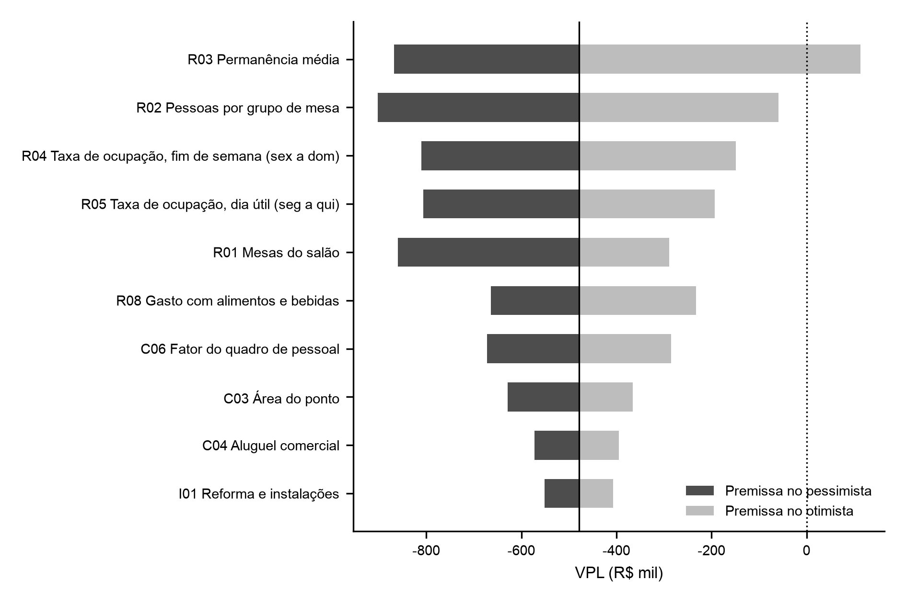

# 9 PLANO FINANCEIRO

> **Rascunho (31/10/2026).** Números do modelo `9_plano_financeiro_modelo.xlsx`, gerado e conferido por `_src/extras/gerar_modelo_financeiro.py` (VPL da planilha igual ao do script nos três cenários). Premissas N6 e enquadramento tributário a confirmar com os caps. 7 e 8.

## 9.1 ÁRVORE DE DIRECIONADORES

A receita da luderia depende de quatro grandezas físicas e de dois preços. O número de pessoas atendidas sai das mesas, do tamanho do grupo, do giro e da taxa de ocupação; a receita sai dessas pessoas multiplicadas pela taxa de entrada e pelo gasto com alimentos e bebidas (A&B). O giro segue o vocabulário do trabalho: horas abertas divididas pela permanência média. A ocupação separa-se em dia útil (segunda a quinta) e fim de semana (sexta a domingo), porque a taxa de entrada também muda nesses dias.

Os custos dividem-se em variáveis, proporcionais à receita, e fixos, que não mudam com o fluxo. O Quadro 9.1 resume a decomposição; cada folha corresponde a uma linha do registro de premissas (seção 9.2).

**Quadro 9.1 – Árvore de direcionadores do modelo financeiro**

| Direcionador | Cálculo | Premissas |
|---|---|---|
| Pessoas por mês | mesas × pessoas por grupo × giro semanal × taxa de ocupação × fator de rampa × semanas por mês, em separado para dia útil e fim de semana | R01 a R05, R11 a R14, M02 |
| Receita de taxa de entrada | pessoas × taxa do dia (útil ou fim de semana) | R06, R07 |
| Receita de A&B | pessoas × gasto por pessoa | R08 |
| Receita de aluguel de jogos | aluguéis por mês × preço médio × fator de rampa | R09, R10 |
| Custos variáveis | Simples Nacional sobre a receita; CMV sobre o A&B; taxa de cartão sobre a receita | C01, C02, aba simples |
| Custos fixos | aluguel e condomínio por m²; pessoal com encargos; pró-labore; utilidades; marketing; contabilidade; sistemas; reposição do acervo | C03 a C13 |
| Investimento | reforma por m²; mobiliário; cozinha e bar; caixa; acervo; pré-operacional; caução; capital de giro | I01 a I08 |

Fonte: elaboração própria, com base em _instrucoes/8_financeiro.md.

O modelo usa preços constantes de outubro de 2026 e taxa mínima de atratividade (TMA) real. A projeção é mensal nos 60 meses, para capturar a rampa de maturação do ano 1, e anual na demonstração do resultado e no fluxo de caixa.

## 9.2 REGISTRO DE PREMISSAS

O modelo tem 38 premissas, cada uma com faixa pessimista, provável e otimista, fonte e nível de evidência. O registro completo está no Apêndice `[letra]` e na aba premissas do modelo; o Quadro 9.2 traz as que movem o VPL em mais de R$ 100 mil entre os extremos da faixa (seção 9.7).

**Quadro 9.2 – Premissas de maior impacto no VPL**

| ID | Premissa | Pessimista | Provável | Otimista | Fonte | Nível |
|---|---|---|---|---|---|---|
| R03 | Permanência média (min) | 137 | 109 | 83 | B3, 4 visitas | N5 |
| R02 | Pessoas por grupo de mesa | 2,8 | 3,6 | 4,4 | B3, 4 visitas | N5 |
| R04 | Taxa de ocupação, fim de semana | 25% | 35% | 45% | B3, noites de sexta e sábado | N5 + N6 |
| R05 | Taxa de ocupação, dia útil | 10% | 18% | 25% | Estimativa do autor | N6 |
| R01 | Mesas do salão | 8 | 10 | 11 | B3, unidades da São Jogue | N5 |
| R08 | Gasto com A&B por pessoa (R$) | 18,00 | 24,00 | 32,00 | B3, NFC-e; cardápio (B1) | N3 + N5 |
| C06 | Quadro de pessoal (pessoas) | 14 | 12 | 10 | CAGED (salários); autor (quadro) | N2 + N6 |
| C03 | Área do ponto (m²) | 220 | 180 | 150 | Estimativa do autor | N6 |
| C04 | Aluguel comercial (R$/m² ao mês) | 64,36 | 54,15 | 45,00 | FipeZap, Salvador, jul/2026 | N2 |
| I01 | Reforma (R$/m²) | 1.400,00 | 1.000,00 | 600,00 | Estimativa do autor | N6 |
| R06 | Taxa de entrada, fim de semana (R$) | 25,00 | 28,00 | 30,00 | São Jogue | N3 + N5 |
| C07 | Encargos sobre a folha | 45% | 37% | 30% | CLT; estimativa do autor | N1 + N6 |
| C01 | CMV de A&B | 35% | 30% | 26% | IBGE, PAS 2023 | N2 |

Fonte: elaboração própria, com dados dos Blocos B1, B3 e B4 (out/2026).

As premissas de demanda vêm da contagem direta na São Jogue (B3). Nas quatro visitas — duas em cada unidade, sempre na noite de sexta ou sábado —, os grupos de mesa tiveram de 2,4 a 4,6 pessoas (média de 3,6) e permanência média de 83 a 137 minutos (média de 109). A taxa de ocupação, medida minuto a minuto pelos registros de entrada e saída de cada grupo, sem contar a mesa do observador, ficou entre 29,9% e 66,9% das mesas, com média de 46,1%. As visitas mediram o pico da semana, por orientação: o objetivo foi conhecer a ocupação máxima e o comportamento de clientes e equipe. Por isso, a ocupação de fim de semana do dia inteiro entra abaixo da noite (35% no provável), e a de dia útil é estimativa do autor (N6), fixada em cerca de metade da de fim de semana.

Os preços seguem os da São Jogue. A taxa de entrada é de R$ 28,00 por pessoa de sexta a domingo e de R$ 22,00 de segunda a quinta, por um turno de 3 horas no salão. O gasto com A&B parte das quatro NFC-e das mesas dos observadores: R$ 23,91 por pessoa, sem taxa, jogos comprados e serviço. O cardápio confirma a ordem de grandeza: hambúrguer a R$ 45,00, batata a R$ 35,00 e drinque a R$ 28,00 (B1).

Os custos vêm de bases públicas sempre que possível. O aluguel comercial de Salvador é de R$ 54,15 por m² ao mês (FipeZap, jul/2026), com alta de 18,9% em 12 meses, usada no pessimista. Os salários são as medianas de admissão em Salvador no Novo CAGED (ago/2025 a jul/2026), quase todas no piso de R$ 1.625,09, com gerente a R$ 2.500,00. O CMV de 30% acompanha a PAS 2023: mercadorias e materiais custaram 29,6% da receita líquida dos serviços de alimentação. Área, reforma, mobiliário, cozinha e despesas gerais não têm cotação e ficam em N6.

A TMA real provável é de 15% ao ano. A Selic meta de 14,0% (BCB, set/2026), descontado o IPCA esperado de 4,3% para 2027 (Focus), dá juro real de 9,3%; somou-se um prêmio de 3 a 9 pontos percentuais pelo risco de pequeno negócio novo.

## 9.3 INVESTIMENTO INICIAL E FINANCIAMENTO

O investimento inicial provável é de R$ 503 mil. A reforma responde por 36% do total, e o capital de giro, por 20% (Tabela 9.1). O acervo de 322 títulos — mediana dos concorrentes do B1, ao preço provável das lojas — custa R$ 61 mil; a São Jogue lista 370 títulos.

**Tabela 9.1 – Investimento inicial por cenário (R$)**

| Item | Pessimista | Provável | Otimista |
|---|---|---|---|
| Reforma e instalações | 308.000,00 | 180.000,00 | 90.000,00 |
| Mobiliário | 60.000,00 | 45.000,00 | 30.000,00 |
| Cozinha e bar | 80.000,00 | 60.000,00 | 40.000,00 |
| Caixa e informática | 8.000,00 | 6.000,00 | 4.000,00 |
| Acervo inicial de jogos | 114.750,94 | 60.884,32 | 42.928,78 |
| Gastos pré-operacionais | 30.000,00 | 20.000,00 | 12.000,00 |
| Caução do aluguel | 42.471,00 | 29.241,00 | 13.500,00 |
| Capital de giro | 206.274,85 | 102.105,31 | 56.403,39 |
| Total | 849.496,78 | 503.230,63 | 288.832,17 |

Fonte: elaboração própria (aba investimento do modelo).

O capital de giro cobre dois meses de custos fixos no provável, o bastante para a rampa de maturação. No ano 1, o EBITDA provável é negativo em R$ 114 mil (seção 9.5): a reserva de R$ 102 mil não cobre o déficit inteiro, e o plano precisa de aporte adicional ou de rampa mais curta. O modelo supõe capital próprio, sem financiamento; o custo de um empréstimo entraria pela TMA, já acima do juro real de mercado.

## 9.4 RECEITAS, CUSTOS E DESPESAS PROJETADOS

Na maturidade, o cenário provável atende 1.460 pessoas por mês, cerca de 48 por dia. A receita bruta mensal chega a R$ 73,1 mil: 51% de taxa de entrada, 48% de A&B e 1% de aluguel de jogos (Tabela 9.2). A rampa começa em 40% da ocupação madura e chega a 100% no mês 9.

**Tabela 9.2 – Receita e custos mensais no cenário provável, mês maduro (R$)**

| Conta | Valor mensal | % da receita bruta |
|---|---|---|
| Taxa de entrada | 37.165,22 | 50,8% |
| Alimentos e bebidas | 35.035,60 | 47,9% |
| Aluguel de jogos | 900,00 | 1,2% |
| Receita bruta | 73.100,81 | 100,0% |
| Simples Nacional | 7.394,05 | 10,1% |
| CMV de A&B | 10.510,68 | 14,4% |
| Taxa de cartão | 2.193,02 | 3,0% |
| Pessoal com encargos (12 pessoas) | 28.198,89 | 38,6% |
| Aluguel, condomínio e IPTU | 11.696,40 | 16,0% |
| Pró-labore e despesas gerais | 11.157,37 | 15,3% |
| Resultado operacional (EBITDA) | 1.950,40 | 2,7% |

Fonte: elaboração própria (abas receitas e custos do modelo).

O pessoal é o maior custo. O quadro de referência tem 12 pessoas em dois turnos — gerente, dois cozinheiros, auxiliar de cozinha, três garçons, atendente de bar, caixa, dois instrutores de jogos e auxiliar de limpeza —, com folha de R$ 20,6 mil e encargos de 37%. A São Jogue teve de três a sete instrutores no salão durante as visitas.

O Simples Nacional custa 10,1% da receita. O modelo enquadra o A&B no anexo I (restaurante, CNAE 5611-2/01) e a taxa de entrada e o aluguel de jogos no anexo III, com alíquotas efetivas de 8,1% e 11,9% no ano maduro. O enquadramento depende do cap. 8.

## 9.5 DEMONSTRATIVOS PROJETADOS

O cenário provável dá prejuízo contábil em todos os anos. O EBITDA é de R$ 23 mil por ano a partir do ano 2, menor que a depreciação de R$ 64 mil (Tabela 9.3). No Simples, o IRPJ e a CSLL estão no DAS; não há imposto sobre o lucro à parte.

**Tabela 9.3 – Demonstração do resultado projetada, cenário provável (R$)**

| Conta | Ano 1 | Anos 2 a 5 (cada) |
|---|---|---|
| Receita bruta | 679.838,00 | 877.210,00 |
| (-) Simples Nacional | -62.916,00 | -88.729,00 |
| (-) CMV e taxa de cartão | -118.144,00 | -152.444,00 |
| Margem de contribuição | 498.777,00 | 636.037,00 |
| (-) Custos fixos | -612.632,00 | -612.632,00 |
| EBITDA | -113.855,00 | 23.405,00 |
| (-) Depreciação e amortização | -63.877,00 | -63.877,00 |
| Lucro líquido | -177.732,00 | -40.472,00 |

Fonte: elaboração própria (aba dre do modelo).

O fluxo de caixa repete o EBITDA, com o investimento no ano 0 e o retorno da caução e do capital de giro no ano 5. Não se considerou valor residual dos demais ativos. O fluxo anual completo está na aba fluxo_caixa do modelo.

## 9.6 INDICADORES DE VIABILIDADE

O negócio não é viável no cenário provável. O VPL a 15% real é negativo em R$ 479 mil, a TIR real é de -21,0% ao ano e o investimento não se paga em 5 anos (Tabela 9.4). A receita madura fica só 3,8% acima do ponto de equilíbrio operacional, de R$ 70,4 mil por mês: o negócio cobre os custos, mas não remunera o investimento.

**Tabela 9.4 – Indicadores de viabilidade por cenário**

| Indicador | Pessimista | Provável | Otimista |
|---|---|---|---|
| Investimento inicial (R$) | 849.496,78 | 503.230,63 | 288.832,17 |
| Receita bruta mensal madura (R$) | 19.407,00 | 73.101,00 | 207.261,00 |
| EBITDA do ano 5 (R$) | -649.981,00 | 23.405,00 | 1.302.846,00 |
| VPL (R$) | -2.824.036,00 | -478.829,00 | 4.263.293,00 |
| TIR real | não há | -21,0% | 394,0% |
| Payback descontado | mais de 5 anos | mais de 5 anos | 0,3 ano |

Fonte: elaboração própria (aba sensibilidade do modelo).

Os cenários extremos põem todas as premissas no mesmo lado da faixa ao mesmo tempo, o que é improvável. Servem de limite, não de previsão. A decisão depende de onde as premissas críticas ficam, e isso é tratado na seção 9.7.

A TMA de 15% real responde pelo custo de oportunidade do capital próprio. Mesmo à TMA otimista de 12%, o VPL provável segue negativo em R$ 467 mil (aba sensibilidade).

## 9.7 TRIANGULAÇÃO, SENSIBILIDADE E PONTO DE RUPTURA

### 9.7.1 Triangulação da receita

A receita provável fica entre os pisos de venda das duas unidades da São Jogue. A Bela Vista emitiu 183 NFC-e entre 10/10 e 16/10/2026 (30,5 por dia) e a Paralela, 209 entre 17/10 e 30/10/2026 (16,1 por dia), pela numeração das notas das visitas (B3). A R$ 90,85 por nota — média das quatro notas das mesas dos observadores —, os pisos são de R$ 84,3 mil e R$ 44,5 mil por mês. O modelo projeta R$ 73,1 mil.

Esses pisos subestimam a venda real. As duas unidades emitem a nota só quando o cliente pede; no restante, entregam o comprovante da maquininha. O intervalo da Paralela inclui ainda o fim de semana do segundo turno das eleições, de movimento baixo. A comparação valida a ordem de grandeza, não o valor: uma unidade madura da São Jogue vende mais que o provável do modelo. A estimativa de demanda do cap. 6 completa a triangulação `[pendente]`.

### 9.7.2 Sensibilidade

Quatro premissas de demanda concentram o risco: permanência média, pessoas por grupo e taxa de ocupação de fim de semana e de dia útil. Cada uma move o VPL em mais de R$ 600 mil entre os extremos da faixa (Figura 9.1). As três primeiras têm dado próprio (N5); a ocupação de dia útil é N6, o que viola a regra de robustez e exige destaque no cap. 10.

**Figura 9.1 – Tornado: VPL com cada premissa no extremo da faixa e as demais no provável**

Fonte: elaboração própria (aba sensibilidade do modelo). Dez premissas de maior amplitude.

A permanência pesa mais que a ocupação porque a taxa de entrada é cobrada por pessoa, não por hora. Com a mesma ocupação, uma permanência menor gira mais grupos pela mesma mesa e multiplica as taxas cobradas. Em contrapartida, a permanência curta tem limite: o turno vendido é de 3 horas, e a média observada já é de 109 minutos.

### 9.7.3 Ponto de ruptura

O negócio é viável enquanto a taxa de ocupação de fim de semana ficar acima de 49,5%, com as demais premissas no provável (Tabela 9.5). Esse valor está acima do provável (35%), mas abaixo do pico medido na Paralela em 30/10 (66,9%) e acima da média das quatro noites (46,1%). No dia útil, a ruptura é de 29,7%, acima do otimista da faixa.

**Tabela 9.5 – Ponto de ruptura das premissas críticas (VPL = 0)**

| ID | Premissa | Provável | Ruptura | Faixa testada |
|---|---|---|---|---|
| R03 | Permanência média (min) | 109 | 87 | 83 a 137 |
| R02 | Pessoas por grupo de mesa | 3,6 | 4,5 | 2,8 a 4,4 |
| R04 | Taxa de ocupação, fim de semana | 35,0% | 49,5% | 25% a 45% |
| R05 | Taxa de ocupação, dia útil | 18,0% | 29,7% | 10% a 25% |
| R01 | Mesas do salão | 10 | 12,5 | 8 a 11 |

Fonte: elaboração própria (aba sensibilidade do modelo).

Só a permanência tem ruptura dentro da faixa testada, perto do extremo otimista; as demais ficam fora dela. O VPL fica positivo pela combinação de premissas: ocupação de 45% no fim de semana e de 23% no dia útil (VPL de R$ 55 mil), ou permanência de 95 minutos com ocupação de 42% no fim de semana (VPL de R$ 65 mil). A discussão passa a ser a plausibilidade dessas combinações, feita no cap. 10.

## 9.8 CHECAGENS DE COERÊNCIA

A capacidade comporta a demanda projetada com folga. As 48 pessoas por dia usam 25% da capacidade do salão — 193 pessoas por dia, com todas as mesas ocupadas em todas as horas abertas e a permanência média. O site de reservas da São Jogue oferece 48 assentos por turno de 3 horas, em três turnos diários.

A equipe é larga para o fluxo provável. Cada funcionário atende 4 pessoas por dia. A folha com encargos custa 38,6% da receita, contra 25,1% de gastos com pessoal na média dos serviços de alimentação (IBGE, PAS 2024, citada no cap. 5). O aluguel com condomínio custa 16,0% da receita, contra 4,0% no setor. Os dois custos fixos explicam a margem baixa e indicam onde o cap. 7 pode cortar: quadro menor no dia útil ou ponto menor.

O preço está acima dos concorrentes. A taxa de entrada de fim de semana, de R$ 28,00, supera a mediana de R$ 18,75 do couvert ou taxa de jogo nos cardápios de 8 concorrentes do B1. A São Jogue pratica esse preço com 4,8 estrelas em 787 avaliações no Google Maps (B1), o que sustenta o posicionamento, mas o plano depende de reproduzir a mesma experiência.

A rampa de 9 meses fica dentro da faixa de 6 a 12 meses, sem ocupação madura no mês 1. A demanda projetada equivale a 17,5 mil visitas por ano, ou 0,7% da população estimada de Salvador em 2026 (IBGE). O número soma visitas, não pessoas distintas, e fica abaixo da penetração que exigiria um mercado novo.
