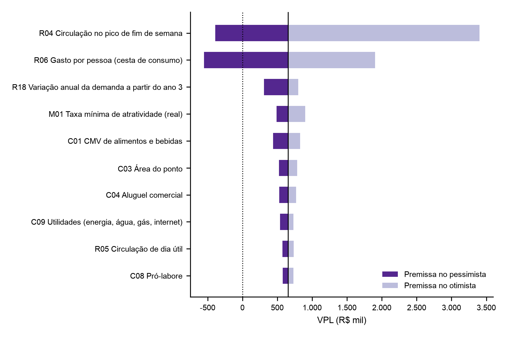

# 9 PLANO FINANCEIRO

> **Rascunho (31/10/2026).** Números do modelo `9_plano_financeiro_modelo.xlsx`, gerado e conferido por `_src/extras/gerar_modelo_financeiro.py` (VPL da planilha igual ao do script nos três cenários). Premissas N6 e enquadramento tributário a confirmar com os caps. 7 e 8.

## 9.1 ÁRVORE DE DIRECIONADORES

A receita da luderia depende de três grandezas físicas e de dois preços. O número de pessoas atendidas sai das mesas ocupadas, das pessoas por mesa e dos giros por dia; a receita sai dessas pessoas multiplicadas pela taxa de entrada e pelo consumo de alimentos e bebidas (A&B). O consumo por pessoa é a cesta de consumo, uma bebida e uma entrada ou prato, dividida pelas pessoas que a compartilham. As mesas ocupadas se separam em fim de semana (sexta a domingo) e dia útil (segunda a quinta), porque só o fim de semana foi medido.

Os custos se dividem em variáveis, proporcionais à receita, e fixos, que não mudam com o fluxo. O Quadro 9.1 resume a decomposição; cada folha corresponde a uma linha do registro de premissas (seção 9.2).

**Quadro 9.1 – Árvore de direcionadores do modelo financeiro**

| Direcionador | Cálculo | Premissas |
|---|---|---|
| Pessoas por mês | mesas ocupadas × pessoas por mesa × giros por dia × dias abertos × fator de rampa × semanas por mês, em separado para fim de semana e dia útil | R02, R04, R05, R11, R12, R15 a R17, M02 |
| Receita de taxa de entrada | pessoas × taxa de entrada | R06 |
| Receita de A&B | pessoas × cesta de consumo ÷ pessoas por cesta | R07, R08 |
| Receita de aluguel de jogos | aluguéis por mês × preço médio × fator de rampa | R09, R10 |
| Custos variáveis | Simples Nacional sobre a receita; CMV sobre o A&B; taxa de cartão sobre a receita | C01, C02, aba simples |
| Custos fixos | aluguel e condomínio por m²; pessoal com encargos; pró-labore; utilidades; marketing; contabilidade; sistemas; reposição do acervo | C03 a C13 |
| Investimento | reforma por m²; mobiliário; cozinha e bar; caixa; acervo; pré-operacional; caução; capital de giro | I01 a I08 |

Fonte: elaboração própria, com base em _instrucoes/8_financeiro.md.

As mesas do salão (R01), a permanência (R03) e o horário (R13 e R14) não entram na receita. Essas premissas conferem se as mesas ocupadas e os giros cabem no salão e no horário (seção 9.8).

O modelo usa preços constantes de outubro de 2026 e taxa mínima de atratividade (TMA) real. A projeção é mensal nos 60 meses, para capturar a rampa de maturação do ano 1, e anual na demonstração do resultado e no fluxo de caixa.

## 9.2 REGISTRO DE PREMISSAS

O modelo tem 40 premissas, cada uma com faixa pessimista, provável e otimista, fonte e nível de evidência. O registro completo está no Apêndice `[letra]` e na aba premissas do modelo; o Quadro 9.2 traz as que movem o VPL em mais de R$ 100 mil entre os extremos da faixa (seção 9.7).

**Quadro 9.2 – Premissas de maior impacto no VPL**

| ID | Premissa | Pessimista | Provável | Otimista | Fonte | Nível |
|---|---|---|---|---|---|---|
| R02 | Pessoas por mesa ocupada | 2,5 | 3,6 | 5,5 | B3, 4 visitas; faixa do autor | N5 + N6 |
| R04 | Mesas ocupadas em média, fim de semana | 2,71 | 4,37 | 6,04 | B3, 4 visitas | N5 |
| R08 | Pessoas por cesta de consumo | 3 | 2 | 1 | Decisão do autor | N6 |
| R15 | Giros por mesa por dia | 3,61 | 4,56 | 5,51 | B3, NFC-e e permanência | N5 |
| C06 | Quadro de pessoal (pessoas) | 14 | 12 | 10 | CAGED (salários); autor (quadro) | N2 + N6 |
| R05 | Mesas ocupadas em dia útil (% do fim de semana) | 40% | 50% | 60% | Estimativa do autor | N6 |
| C03 | Área do ponto (m²) | 220 | 180 | 150 | Estimativa do autor | N6 |
| C04 | Aluguel comercial (R$/m² ao mês) | 64,35 | 54,15 | 45,00 | FipeZap, Salvador, jul/2026 | N2 |
| I01 | Reforma (R$/m²) | 1.400,00 | 1.000,00 | 600,00 | Estimativa do autor | N6 |
| C01 | CMV de A&B | 35% | 30% | 26% | IBGE, PAS 2023 | N2 |
| C07 | Encargos sobre a folha | 45% | 37% | 30% | CLT; estimativa do autor | N1 + N6 |
| C09 | Utilidades (R$ por mês) | 6.000,00 | 4.500,00 | 3.500,00 | Estimativa do autor | N6 |

Fonte: elaboração própria, com dados dos Blocos B1, B3 e B4 (out/2026).

As premissas de demanda vêm da contagem direta na São Jogue (B3). Nas quatro visitas — duas em cada unidade, sempre na noite de sexta ou sábado —, os grupos de mesa tiveram de 2,4 a 4,6 pessoas (média de 3,6) e permanência média de 83 a 137 minutos (média de 109). As mesas ocupadas, medidas minuto a minuto pelos registros de entrada e saída de cada grupo, sem contar a mesa do observador, ficaram entre 2,69 e 6,02 por visita, com média de 4,37. A faixa das mesas ocupadas vai 38% para cada lado da média: é a distância média dos extremos observados até ela. As pessoas por mesa vão de 2,5 a 5,5, pontos médios de grupos de 2 ou 3 e de 5 ou 6 pessoas. As visitas mediram o pico da semana, por orientação; as mesas ocupadas em dia útil são estimativa do autor (N6), fixada em cerca de metade das do fim de semana.

Os giros partem de dois limites medidos. No pessimista, 3,61 grupos por mesa ocupada por dia fazem o cenário atender 16,1 clientes por dia, as NFC-e emitidas por dia na Paralela entre 17/10 e 30/10/2026. Cada cliente recebe uma comanda e uma nota, mas a nota só sai quando ele pede; o número de notas é, portanto, piso do número de clientes (seção 9.7.1). No otimista, o giro de 5,51 divide as 10 horas abertas por dia, das 12h às 22h, pela permanência média de 109 minutos: as mesas ocupadas recebem grupos o dia inteiro. O provável fica na média dos dois, com 4,56 giros.

Os preços vêm dos cardápios dos concorrentes (seção 6.3). A taxa de entrada é a média das 22 casas que a cobram, R$ 18,68 por pessoa (mediana de R$ 20,00), cobrada de todos os clientes em todos os dias. O consumo parte da cesta de consumo média de 36 casas, R$ 50,82 (mediana de R$ 50,25; R$ 48,50 na São Jogue). A cesta é dividida por três pessoas no pessimista, duas no provável e uma no otimista: de R$ 16,94 a R$ 50,82 por pessoa. Taxa e cesta são iguais nos três cenários; a variação do consumo entra pelas pessoas por cesta. Os dados de pedidos da contagem direta ficaram fora do modelo, porque a coleta se mostrou inviável (seção 11.3).

Os custos vêm de bases públicas sempre que possível. O aluguel comercial de Salvador é de R$ 54,15 por m² ao mês (FipeZap, jul/2026), com alta de 18,9% em 12 meses, usada no pessimista. Os salários são as medianas de admissão em Salvador no Novo CAGED (ago/2025 a jul/2026), quase todas no piso de R$ 1.625,09, com gerente a R$ 2.500,00. O CMV de 30% acompanha a PAS 2023: mercadorias e materiais custaram 29,6% da receita líquida dos serviços de alimentação. Área, reforma, mobiliário, cozinha e despesas gerais não têm cotação e ficam em N6.

A TMA real provável é de 15% ao ano. A Selic meta de 14,0% (BCB, set/2026), descontado o IPCA esperado de 4,3% para 2027 (Focus), dá juro real de 9,3%; a ele foi somado um prêmio de 3 a 9 pontos percentuais pelo risco de pequeno negócio novo.

## 9.3 INVESTIMENTO INICIAL E FINANCIAMENTO

O investimento inicial provável é de R$ 503 mil. A reforma responde por 36% do total, e o capital de giro, por 20% (Tabela 9.1). O acervo de 322 títulos — mediana dos concorrentes do B1, ao preço provável das lojas — custa R$ 61 mil; a São Jogue lista 370 títulos.

**Tabela 9.1 – Investimento inicial por cenário (R$)**

| Item | Pessimista | Provável | Otimista |
|---|---|---|---|
| Reforma e instalações | 308.000,00 | 180.000,00 | 90.000,00 |
| Mobiliário | 60.000,00 | 45.000,00 | 30.000,00 |
| Cozinha e bar | 80.000,00 | 60.000,00 | 40.000,00 |
| Caixa e informática | 8.000,00 | 6.000,00 | 4.000,00 |
| Acervo inicial de jogos | 114.750,94 | 60.884,32 | 42.928,78 |
| Gastos pré-operacionais | 30.000,00 | 20.000,00 | 12.000,00 |
| Caução do aluguel | 42.471,00 | 29.241,00 | 13.500,00 |
| Capital de giro | 206.274,85 | 102.105,31 | 56.403,39 |
| Total | 849.496,78 | 503.230,63 | 288.832,17 |

Fonte: elaboração própria (aba investimento do modelo).

O capital de giro cobre dois meses de custos fixos no provável. No ano 1, o EBITDA provável é negativo em R$ 153 mil (seção 9.5): a reserva de R$ 102 mil não cobre o déficit, e o EBITDA segue negativo depois da rampa, o que exigiria aportes anuais. O modelo supõe capital próprio, sem financiamento; o custo de um empréstimo entraria pela TMA, já acima do juro real de mercado.

## 9.4 RECEITAS, CUSTOS E DESPESAS PROJETADOS

Na maturidade, o cenário provável atende 1.554 pessoas por mês, cerca de 51 por dia. A receita bruta mensal chega a R$ 69,4 mil: 42% de taxa de entrada, 57% de A&B e 1% de aluguel de jogos (Tabela 9.2). A rampa começa em 40% do fluxo maduro e chega a 100% no mês 9.

**Tabela 9.2 – Receita e custos mensais no cenário provável, mês maduro (R$)**

| Conta | Valor mensal | % da receita bruta |
|---|---|---|
| Taxa de entrada | 29.034,73 | 41,8% |
| Alimentos e bebidas | 39.495,31 | 56,9% |
| Aluguel de jogos | 900,00 | 1,3% |
| Receita bruta | 69.430,04 | 100,0% |
| Simples Nacional | 6.668,45 | 9,6% |
| CMV de A&B | 11.848,59 | 17,1% |
| Taxa de cartão | 2.082,90 | 3,0% |
| Pessoal com encargos (12 pessoas) | 28.198,89 | 40,6% |
| Aluguel, condomínio e IPTU | 11.696,40 | 16,8% |
| Pró-labore e despesas gerais | 11.157,37 | 16,1% |
| Resultado operacional (EBITDA) | -2.222,56 | -3,2% |

Fonte: elaboração própria (abas receitas e custos do modelo).

O pessoal é o maior custo. O quadro de referência tem 12 pessoas em dois turnos — gerente, dois cozinheiros, auxiliar de cozinha, três garçons, atendente de bar, caixa, dois instrutores de jogos e auxiliar de limpeza —, com folha de R$ 20,6 mil e encargos de 37%. A São Jogue teve de três a sete instrutores no salão durante as visitas.

O A&B é a maior receita: a taxa média dos concorrentes, de R$ 18,68, fica abaixo da cesta dividida por dupla, de R$ 25,41. O CMV sobe com ele e chega a 17,1% da receita.

O Simples Nacional custa 9,6% da receita. O modelo enquadra o A&B no anexo I (restaurante, CNAE 5611-2/01) e a taxa de entrada e o aluguel de jogos no anexo III, com alíquotas efetivas de 8,0% e 11,7% no ano maduro. O enquadramento depende do cap. 8.

## 9.5 DEMONSTRATIVOS PROJETADOS

O cenário provável dá prejuízo em todos os anos. O EBITDA fica negativo em R$ 27 mil por ano a partir do ano 2, e a depreciação de R$ 64 mil aumenta o prejuízo contábil (Tabela 9.3). No Simples, o IRPJ e a CSLL estão no DAS; não há imposto sobre o lucro à parte.

**Tabela 9.3 – Demonstração do resultado projetada, cenário provável (R$)**

| Conta | Ano 1 | Anos 2 a 5 (cada) |
|---|---|---|
| Receita bruta | 645.699,00 | 833.160,00 |
| (-) Simples Nacional | -56.987,00 | -80.021,00 |
| (-) CMV e taxa de cartão | -129.563,00 | -167.178,00 |
| Margem de contribuição | 459.149,00 | 585.961,00 |
| (-) Custos fixos | -612.632,00 | -612.632,00 |
| EBITDA | -153.483,00 | -26.671,00 |
| (-) Depreciação e amortização | -63.877,00 | -63.877,00 |
| Lucro líquido | -217.360,00 | -90.548,00 |

Fonte: elaboração própria (aba dre do modelo).

O fluxo de caixa repete o EBITDA, com o investimento no ano 0 e o retorno da caução e do capital de giro no ano 5. O modelo não considera valor residual dos demais ativos. O fluxo anual completo está na aba fluxo_caixa do modelo.

## 9.6 INDICADORES DE VIABILIDADE

O negócio não é viável no cenário provável. O VPL a 15% real é negativo em R$ 638 mil, a TIR real é de -37,6% ao ano e o investimento não se paga em 5 anos (Tabela 9.4). A receita madura fica 4,4% abaixo do ponto de equilíbrio operacional, de R$ 72,6 mil por mês: o negócio não cobre os custos fixos.

**Tabela 9.4 – Indicadores de viabilidade por cenário**

| Indicador | Pessimista | Provável | Otimista |
|---|---|---|---|
| Investimento inicial (R$) | 849.496,78 | 503.230,63 | 288.832,17 |
| Receita bruta mensal madura (R$) | 17.516,00 | 69.430,00 | 300.082,00 |
| EBITDA do ano 5 (R$) | -668.883,00 | -26.671,00 | 2.010.106,00 |
| VPL (R$) | -2.878.100,00 | -637.604,00 | 6.644.840,00 |
| TIR real | não há | -37,6% | 579,5% |
| Payback descontado | mais de 5 anos | mais de 5 anos | 0,2 ano |

Fonte: elaboração própria (aba sensibilidade do modelo).

Os cenários extremos põem todas as premissas no mesmo lado da faixa ao mesmo tempo, o que é improvável. Servem de limite, não de previsão. A decisão depende de onde as premissas críticas ficam, e isso é tratado na seção 9.7.

A TMA de 15% real responde pelo custo de oportunidade do capital próprio. À TMA otimista de 12%, o VPL provável fica no mesmo valor (aba sensibilidade): com EBITDA quase nulo nos anos 2 a 5, a taxa de desconto pesa pouco.

## 9.7 TRIANGULAÇÃO, SENSIBILIDADE E PONTO DE RUPTURA

### 9.7.1 Triangulação da receita

O fluxo provável fica acima dos dois pisos de clientes da São Jogue. A Bela Vista emitiu 183 NFC-e entre 10/10 e 16/10/2026 (30,5 por dia) e a Paralela, 209 entre 17/10 e 30/10/2026 (16,1 por dia), pela numeração das notas das visitas (B3). Cada cliente recebe uma comanda e uma nota; o modelo projeta 51,2 pessoas por dia no provável, 1,7 vez o piso da Bela Vista, e o pessimista foi calibrado no piso da Paralela.

Esses pisos subestimam o fluxo real. As duas unidades emitem a nota só quando o cliente pede, e quase nenhum pede; no restante, entregam o comprovante da maquininha. O intervalo da Paralela inclui ainda o fim de semana do segundo turno das eleições, de movimento baixo. A comparação valida a ordem de grandeza, não o valor. A estimativa de demanda do cap. 6 completa a triangulação `[pendente]`.

### 9.7.2 Sensibilidade

Quatro premissas de demanda concentram o risco: pessoas por mesa, mesas ocupadas no fim de semana, pessoas por cesta de consumo e giros por dia. Cada uma move o VPL em mais de R$ 700 mil entre os extremos da faixa (Figura 9.1). Três têm dado próprio (N5); as pessoas por cesta são decisão do autor (N6), o que viola a regra de robustez e exige destaque no cap. 10.

**Figura 9.1 – Tornado: VPL com cada premissa no extremo da faixa e as demais no provável**

Fonte: elaboração própria (aba sensibilidade do modelo). Dez premissas de maior amplitude.

As pessoas por mesa e as mesas ocupadas pesam mais porque multiplicam a taxa e a cesta ao mesmo tempo. As pessoas por cesta pesam só sobre o A&B, mas o A&B já é 56,9% da receita. O giro pesa menos que as três porque a faixa dele é mais estreita, entre dois limites medidos.

A simulação de Monte Carlo sorteia 10 mil cenários, com cada premissa dentro da própria faixa e independente das demais. O VPL fica positivo em 25,2% deles (Apêndice `[letra]`).

### 9.7.3 Ponto de ruptura

O negócio é viável enquanto as mesas ocupadas no fim de semana ficarem acima de 5,98 em média, com as demais premissas no provável (Tabela 9.5). Esse valor fica perto do otimista (6,04) e do pico das quatro visitas, de 6,02 mesas na Paralela em 30/10/2026.

**Tabela 9.5 – Ponto de ruptura das premissas críticas (VPL = 0)**

| ID | Premissa | Provável | Ruptura | Faixa testada |
|---|---|---|---|---|
| R02 | Pessoas por mesa ocupada | 3,6 | 4,9 | 2,5 a 5,5 |
| R04 | Mesas ocupadas em média, fim de semana | 4,37 | 5,98 | 2,71 a 6,04 |
| R08 | Pessoas por cesta de consumo | 2 | 1,13 | 3 a 1 |
| R15 | Giros por mesa por dia | 4,56 | 6,23 | 3,61 a 5,51 |

Fonte: elaboração própria (aba sensibilidade do modelo).

Só o giro tem ruptura fora da faixa testada: com as demais premissas no provável, nem o horário inteiro ocupado com a permanência média torna o negócio viável. As outras três rupturas ficam no alto das faixas. Com o quadro de 12, duas premissas acima do provável também não bastam: 5,0 mesas ocupadas com uma cesta para 1,5 pessoa dão VPL de -R$ 68 mil. A discussão passa a ser a plausibilidade dessas combinações e o efeito da equipe do cap. 7, feita no cap. 10.

## 9.8 CHECAGENS DE COERÊNCIA

A capacidade comporta a demanda projetada com folga. As 51 pessoas por dia usam 27% da capacidade do salão — 193 pessoas por dia, com todas as mesas ocupadas em todas as horas abertas e a permanência média. Os giros também cabem no horário: 4,56 grupos de 109 minutos ocupam 8,3 horas de mesa, contra 9,3 horas abertas por dia no fim de semana.

A equipe é larga para o fluxo provável. Cada funcionário atende 4 pessoas por dia. A folha com encargos custa 40,6% da receita, contra 25,1% de gastos com pessoal na média dos serviços de alimentação (IBGE, PAS 2024, citada no cap. 5). O aluguel com condomínio custa 16,8% da receita, contra 4,0% no setor. Os dois custos fixos explicam a margem negativa e indicam onde o cap. 7 pode cortar: quadro menor no dia útil ou ponto menor.

O preço fica no meio dos concorrentes. A taxa de entrada de R$ 18,68 é a média das 22 casas que a cobram, abaixo da mediana de R$ 20,00 e da São Jogue, de R$ 28,00 no fim de semana (seção 6.3). O preço não exige posicionamento acima do mercado.

A rampa de 9 meses fica dentro da faixa de 6 a 12 meses, sem fluxo maduro no mês 1. A demanda projetada equivale a 18,7 mil visitas por ano, ou 0,7% da população estimada de Salvador em 2026 (IBGE). O número soma visitas, não pessoas distintas, e fica abaixo da penetração que exigiria um mercado novo.
