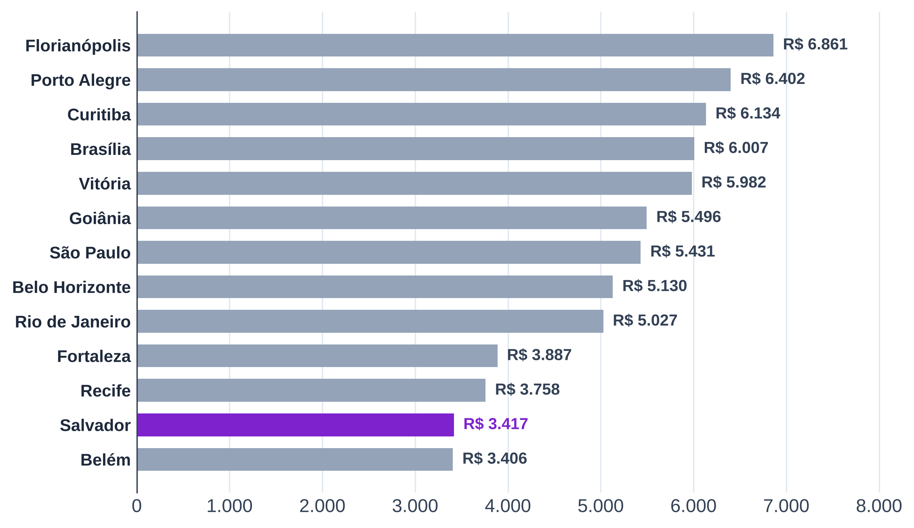
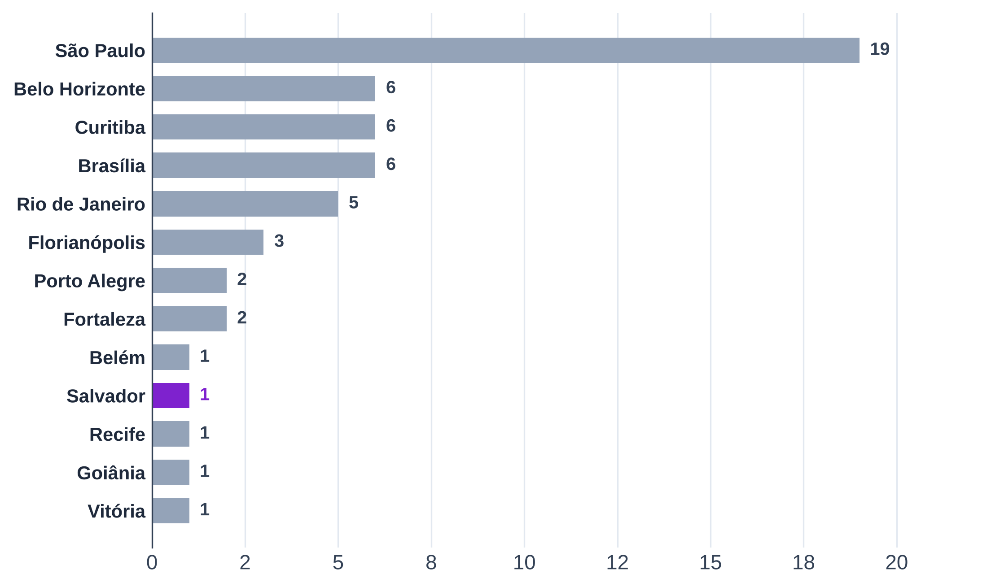
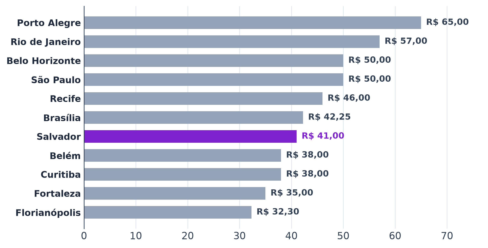
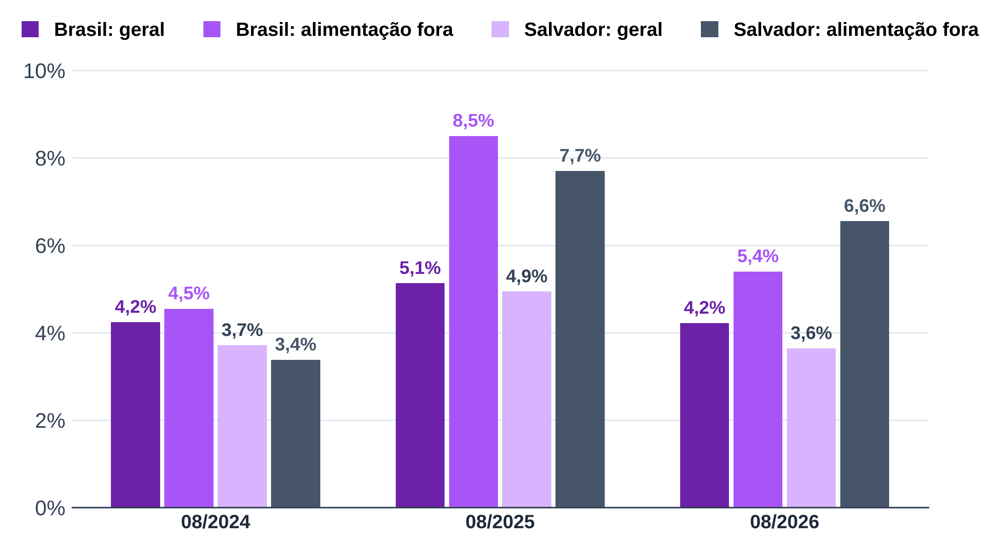

# 5 ANÁLISE DE MERCADO

A análise de mercado verifica se Salvador comporta mais uma luderia e em que condições. O capítulo parte do setor, passa pelo público e pela concorrência e termina nos fornecedores e no macroambiente. Cada seção fecha com a decisão do plano que o dado afeta.

## 5.1 ANÁLISE DO SETOR

### 5.1.1 Serviços às famílias no Brasil

Os serviços prestados às famílias cresceram acima da inflação depois da pandemia. A receita bruta do segmento passou de R$ 223,9 bilhões, em 2019, para R$ 388,9 bilhões, em 2023, com ganho real em torno de 36% (IBGE, PAS, tabela 2611) [script].

O lazer cresceu mais que a alimentação e atraiu novas empresas. Entre 2019 e 2023, a receita das atividades culturais, recreativas e esportivas subiu 95,4%, e a dos serviços de alimentação, 67,7% (IBGE, PAS, tabela 2611). No mesmo período, o número de empresas de alimentação caiu 8,7%, e o de atividades culturais e recreativas cresceu 35,1% (IBGE, PAS, tabela 2619). A luderia disputa clientes como bar, onde a concorrência é por escala, e se diferencia como lazer, onde há espaço para entrantes.

A mesma pesquisa mostra a estrutura de custos dos serviços de alimentação. Em 2024, os gastos com pessoal equivaleram a 25,1% da receita operacional líquida dos serviços de alimentação, o consumo de mercadorias a 26,8% e o aluguel a 4,0% (IBGE, PAS 2024, tabela 10758) [script]. Esses percentuais são o teto de comparação das premissas de custo do cap. 9.

### 5.1.2 Jogos de tabuleiro e luderias

Os jogos de tabuleiro e cartas passaram de 9,1% para 13,1% das vendas da indústria de brinquedos entre 2017 e 2025 (ABRINQ, 2026). O número sustenta o crescimento do hábito de jogar, não a demanda por luderias. Não há levantamento oficial nem setorial sobre luderias, e o formato não tem código próprio na CNAE (seção 8.1): o tamanho do segmento é medido pelo Bloco B1 (seção 5.3).

O formato já tem escala fora do Brasil. No Reino Unido, o número de locais de *competitive socialising* cresceu 38% entre 2018 e 2023, e os locais que combinam várias atividades cresceram 455% no mesmo período (SAVILLS, 2023). A procura por experiências presenciais depois da pandemia de covid-19 sustentou esse crescimento (SAVILLS, 2023). O dado mostra um formato em alta, mas medido fora do Brasil: a demanda em Salvador precisa de evidência própria.

### 5.1.3 Alimentação fora do lar na Bahia

O consumo fora do domicílio pesa mais no orçamento baiano que na média nacional. Na Bahia, a alimentação fora do domicílio respondia por 36,1% da despesa familiar com alimentação, contra 32,8% no Brasil, e as bebidas alcoólicas consumidas fora de casa, por 2,6%, contra 1,5% (IBGE, POF 2017-2018). A propensão local favorece um modelo de receita apoiado em alimentos e bebidas, com o jogo como motivo da visita. O dado entra como evidência de hábito (N2), não como gasto atual.

## 5.2 PÚBLICO-ALVO E SEGMENTAÇÃO

Do setor, a análise passa ao público da cidade. Salvador tem público em número, mas com renda menor. A população estimada em 2026 é de 2.559.945 habitantes (IBGE, Estimativas da População), e 30,5% dos residentes tinham de 20 a 39 anos no Censo 2022. O rendimento médio do trabalho, de R$ 3.417,00 no 2º trimestre de 2026, coloca Salvador em 22º lugar entre as 27 capitais e em penúltimo entre as que têm luderia no B1 (Figura 5.1), e o rendimento domiciliar per capita caiu de R$ 1.985,00, em 2023, para R$ 1.900,00, em 2025 (IBGE, PNAD Contínua). A renda menor pesa na definição do preço de entrada (seção 6.3), e o ponto precisa estar onde a renda se concentra (seção 6.4).

**Figura 5.1 – Rendimento médio do trabalho nas capitais com luderia no B1, 2º trimestre de 2026 (R$)**

Fonte: elaboração própria, com base no IBGE, PNAD Contínua (2º trimestre de 2026).

O jogo de tabuleiro moderno valoriza a interação presencial. Em entrevistas com jogadores adultos, Sarpa (2016, p. 39–40) mostra que eles descrevem o jogo como o elo que reúne as pessoas: o convívio importa mais que a partida e se concentra no fim de semana, com amigos.

Para dimensionar esse público, os dados disponíveis têm um viés. Os levantamentos de perfil, como o Censo Ludopedia, usam amostras autosselecionadas de usuários de portais especializados (FIGUEIREDO; MANTOVANI, 2022, p. 4–5). Eles descrevem o jogador engajado, dono de acervo, e não o frequentador médio de uma luderia. Por isso, o que o frequentador valoriza sai das avaliações dos concorrentes, e não de levantamentos de jogadores.

Nas avaliações, o atendimento é o tema mais citado: aparece em 55,7% delas, seguido de alimentos e bebidas (40,6%) e acervo (26,9%) (Bloco B2, provisório). A explicação de regras pela equipe aparece em 16,4% e, quando negativa, acompanha nota média de 2,83. Preço aparece em 12,8%, com nota média de 3,11 nas menções negativas. A decisão afetada é o quadro de pessoal, com instrutor de jogos, e o peso do cardápio na proposta de valor.

Os estudos de fora do Brasil apontam na mesma direção. Em nove *board game cafés* de Tóquio, fazer amigos foi a principal motivação dos frequentadores, e 44% dos entrevistados iam sozinhos; a equipe atuava como anfitriã, explicava as regras e formava grupos com quem chegava sozinho (NOVAES; KANYAT, 2025, p. 87, 89). Na Inglaterra, com 50 entrevistas e observação em 24 locais, Kviat (2024, p. 76–77) conclui que o jogo dá foco e estrutura à interação, o que facilita a socialização de quem não se sente à vontade em um pub. A equipe faz parte do produto, e não só do serviço de mesa. Ainda assim, no Reino Unido, os atributos mais exigidos nos locais de *competitive socialising* são os mesmos de qualquer bar: segurança (70%), preço (69%) e qualidade da comida (63%) (KAM INSIGHT, 2022, p. 17–21). O jogo diferencia o local, mas não dispensa o básico da hospitalidade.

[Pendente: ocasiões de consumo (B2) e tamanho do público em Salvador.]

## 5.3 ANÁLISE DA CONCORRÊNCIA

O Bloco B1 identificou 54 luderias com mais de 100 avaliações no Google Maps nas 14 metrópoles da REGIC (IBGE, 2020), em outubro de 2026. São Paulo concentra 19; Belo Horizonte, Brasília e Curitiba têm seis cada; Rio de Janeiro, cinco; Florianópolis, três; Fortaleza e Porto Alegre, duas; Belém, Goiânia, Recife, Salvador e Vitória, uma; Manaus não tem nenhuma (Figura 5.2).

**Figura 5.2 – Luderias com mais de 100 avaliações por metrópole**

Fonte: elaboração própria, com base no Bloco B1 (Google Places API, 15/10/2026).

A nota mediana é 4,7 (de 4,2 a 5,0), e o volume mediano de avaliações é 621 (de 105 a 5.137). Nota alta é condição de entrada no mercado, não diferencial; o volume de avaliações separa as casas e alimenta a estimativa de fluxo.

### 5.3.1 Densidade e concorrência em Salvador

Salvador tem a menor oferta de luderias por habitante entre as metrópoles com ao menos uma casa: cerca de 0,04 por 100 mil habitantes, contra 0,16 em São Paulo e 0,33 em Curitiba [script]. A baixa densidade indica espaço para um segundo concorrente, mas também pode refletir a renda menor, e a ocupação observada na São Jogue (Bloco B3) testa as duas leituras.

Na prática, a concorrência local se resume a uma casa. A São Jogue é a única luderia de Salvador no recorte. A unidade Bela Vista tem nota 4,8, 787 avaliações e abre 68 horas por semana; a Paralela, mais nova, tem 16 avaliações. As duas ficam dentro de shoppings (Bela Vista e Paralela), no eixo da Avenida Paralela, o que orienta a escolha de bairro (seção 6.4). O aluguel de jogos para levar para casa é o substituto mais próximo, com seis acervos em Salvador na plataforma Acervo de Jogos, mas não compete com a ocasião social.

### 5.3.2 Acervo e preço

O acervo dos concorrentes tem mediana de 468 títulos (de 190 a 1.357), nas 17 casas com acervo conhecido. O couvert ou taxa de entrada foi encontrado em 22 dos 53 concorrentes, com mediana de R$ 20,00 por pessoa (de R$ 5,00 a R$ 40,00); a Ludus declara que não cobra, e nos outros 30 o couvert não foi encontrado. Entre as que divulgam a política, o couvert é a regra (seção 6.3). O consumo por pessoa, uma bebida e uma entrada ou prato, tem mediana de R$ 50,25 em 36 casas, com faixa interquartil de R$ 38,38 a R$ 65,70, e de R$ 48,50 na São Jogue (Bloco B1, 2026). Salvador fica no meio da distribuição por metrópole (Figura 5.3).

**Figura 5.3 – Consumo por pessoa (uma bebida e uma entrada ou prato), mediana por metrópole (R$)**

Fonte: elaboração própria, com base nos cardápios do Bloco B1 (2026).

Fora do Brasil, a cobrança segue dois modelos. Nos estabelecimentos especializados do Reino Unido, o cliente paga uma taxa fixa de acesso ao acervo, e comida e bebida são opcionais (KVIAT, 2024, p. 77); em Tóquio, a cobrança é por hora, em média 470 ienes, com preço menor nas tardes de dia útil (NOVAES; KANYAT, 2025, p. 87). Os dois modelos, com o couvert dos concorrentes, são as referências da taxa de entrada.

Os levantamentos de jogadores mostram o preço como a barreira mais citada: 57% dos respondentes do Censo Ludopedia apontam o preço elevado como a maior preocupação com os jogos fabricados no Brasil (FIGUEIREDO; MANTOVANI, 2022, p. 4). O dado tem leitura dupla. O acervo da luderia dá acesso a jogos que o cliente não compraria; o jogador que já tem acervo, porém, compara o gasto no bar com a compra de um jogo, e entrevistados de Sarpa (2016, p. 41) descrevem esse gasto como "desperdício de dinheiro". A taxa de entrada precisa equilibrar os dois lados dessa tensão (seção 6.3).

### 5.3.3 Cinco forças

Os dados das seções anteriores alimentam a análise das cinco forças, resumida no Quadro 5.1.

**Quadro 5.1 – Cinco forças aplicadas à luderia em Salvador**

| Força | Intensidade | Evidência |
|---|---|---|
| Rivalidade | Baixa no formato, alta no bar comum | 1 luderia no recorte (B1); alimentação concentra receita (PAS) |
| Ameaça de entrantes | Média | Acervo barato frente à cozinha; barreira na curadoria e na explicação de jogos (B2) |
| Substitutos | Alta | Bares, aluguel de jogos, lazer em casa |
| Poder dos fornecedores | Baixo a médio | Jogos com várias lojas (seção 5.4); A&B com muitos distribuidores |
| Poder dos clientes | Médio | Renda abaixo da média das capitais (seção 5.2); custo de troca baixo |

Fonte: elaboração própria.

## 5.4 FORNECEDORES

O principal insumo próprio da luderia é o acervo. Em oito lojas especializadas, 2.342 jogos tinham preço mediano de R$ 130,00, com faixa interquartil de R$ 69,90 a R$ 249,88 (Bloco B1, 2026). Um acervo do tamanho mediano dos concorrentes custaria cerca de R$ 61 mil [script]. [Pendente: alimentos e bebidas, mobiliário e equipamentos.]

A composição do acervo também encontra apoio nos levantamentos de jogadores. Mecânicas de fácil apreensão aumentam a probabilidade de sucesso de um título entre usuários brasileiros, e jogos de guerra e de cartas colecionáveis a reduzem (FIGUEIREDO; MANTOVANI, 2022, p. 12). Para a luderia, o resultado favorece um acervo de jogos de regras simples (seção 7.4).

## 5.5 MACROAMBIENTE (PESTEL)

A análise PESTEL lê o macroambiente em seis dimensões: política, econômica, social, tecnológica, ambiental e legal (seção 2.2). Cada dimensão entra pelo fator que muda uma decisão do plano.

No campo político, o fator de maior efeito é a reforma tributária do consumo. A Emenda Constitucional n. 132/2023 e a Lei Complementar n. 214/2025 trocam os tributos sobre o consumo pelo IBS e pela CBS, com transição a partir de 2026 [AV]. A reforma mantém o Simples Nacional e abre a opção de recolher IBS e CBS por fora a partir de 2027, que a luderia não usa, por vender ao consumidor final (seção 8.1).

No campo econômico, os juros altos encarecem o capital. A meta da Selic estava em 14,00% ao ano em setembro de 2026, e o mercado espera 12,00% no fim de 2027 (BCB, SGS e Focus). A taxa de desconto do cap. 9 parte dessa curva.

A inflação da alimentação fora do domicílio corre acima da geral, e mais em Salvador. Em 12 meses até agosto de 2026, o IPCA subiu 3,64% em Salvador, e a alimentação fora do domicílio, 6,55% (IBGE, IPCA). Em Salvador, a alimentação fora subiu mais que o índice geral em 2025 e em 2026 (Figura 5.4). Por isso, o reajuste de preço do cap. 9 usa o subitem de Salvador.

**Figura 5.4 – IPCA acumulado em 12 meses até agosto: geral e alimentação fora do domicílio**

Fonte: elaboração própria, com base no IBGE, IPCA (tabela 7060).

O custo do ponto segue a mesma tendência de alta. O aluguel comercial em Salvador chegou a R$ 54,15 por m² em julho de 2026, alta de 18,9% em 12 meses, contra 7,8% em São Paulo (FIPE, Índice FipeZAP). O aluguel é o principal custo fixo e entra como premissa de risco na escolha do ponto (seção 6.4) e na sensibilidade (cap. 9).

No campo social, dois fatores atuam em sentidos opostos. O hábito de comer e beber fora de casa pesa mais no orçamento baiano que na média nacional (seção 5.1.3) e favorece um modelo de receita apoiado em alimentos e bebidas. A renda menor de Salvador (seção 5.2) limita a taxa de entrada e o consumo por pessoa.

No campo tecnológico, o efeito mais direto está na divulgação, que acontece nas redes sociais. As 49 luderias com perfil no Instagram têm mediana de 14.021 seguidores, e a São Jogue tem 38.492 (Bloco B1, 2026). O Instagram é o canal principal do plano de comunicação (cap. 6).

No campo ambiental, o efeito sobre o negócio é residual. O acervo é um bem durável, usado por muitos clientes ao longo de anos, e o manejo dos resíduos da cozinha entra na licença sanitária (seção 8.2). Por isso, a dimensão não é detalhada.

Por fim, no campo legal, as normas de maior efeito são as de licença e de venda. O alvará depende de a zona do ponto admitir serviço de alimentação e lazer (Lei municipal n. 9.148/2016) [AV], e a lotação aprovada pelo Corpo de Bombeiros fixa o teto de mesas. A venda de bebida alcoólica a menores de 18 anos é crime (Lei n. 8.069/1990, art. 243), o que exige conferência de idade no caixa, e a música ambiente gera retribuição ao ECAD (Lei n. 9.610/1998, art. 68). As obrigações e o custo de cada uma estão no cap. 8; a regulação municipal de ruído e horário ainda precisa ser conferida [BUSCAR].

**Referências citadas neste capítulo**

ABRINQ. *Anuário da Abrinq 2026*. São Paulo: Associação Brasileira dos Fabricantes de Brinquedos, 2026. `[AV]`

BANCO CENTRAL DO BRASIL (BCB). *Relatório Focus*: expectativas de mercado de 11 set. 2026. Brasília, 2026.

BANCO CENTRAL DO BRASIL (BCB). *Sistema Gerenciador de Séries Temporais (SGS)*: séries 432, 1619 e 13522. Brasília, 2026. Acesso em: 14 out. 2026.

BRASIL. Lei nº 8.069, de 13 de julho de 1990. Dispõe sobre o Estatuto da Criança e do Adolescente e dá outras providências. *Diário Oficial da União*: seção 1, Brasília, DF, 16 jul. 1990. [AV]

BRASIL. Lei nº 9.610, de 19 de fevereiro de 1998. Altera, atualiza e consolida a legislação sobre direitos autorais e dá outras providências. *Diário Oficial da União*: seção 1, Brasília, DF, 20 fev. 1998. [AV]

BRASIL. Constituição (1988). Emenda Constitucional nº 132, de 20 de dezembro de 2023. Altera o Sistema Tributário Nacional. *Diário Oficial da União*: seção 1, Brasília, DF, 21 dez. 2023. [AV]

BRASIL. Lei Complementar nº 214, de 16 de janeiro de 2025. Institui o Imposto sobre Bens e Serviços (IBS), a Contribuição Social sobre Bens e Serviços (CBS) e o Imposto Seletivo (IS). *Diário Oficial da União*: seção 1, Brasília, DF, 16 jan. 2025. [AV]

FIGUEIREDO, Caio Moretti de; MANTOVANI, Daielly Melina Nassif. Jogos de tabuleiro modernos e o consumidor brasileiro: uma análise das características desejáveis no produto via modelos estatístico-preditivos. In: SEMINÁRIOS EM ADMINISTRAÇÃO, 25., 2022, São Paulo. *Anais* [...]. São Paulo: FEA-USP, 2022. Disponível em: https://login.semead.com.br/25semead/anais/arquivos/1057.pdf. [AV: data de acesso]

FUNDAÇÃO INSTITUTO DE PESQUISAS ECONÔMICAS (FIPE). *Índice FipeZAP*: locação comercial, julho de 2026. São Paulo, 2026.

IBGE. *Censo Demográfico 2022*: população residente por idade. Rio de Janeiro: IBGE, 2023. `[AV ano]`

IBGE. *Estimativas da população residente*: 2026. Rio de Janeiro: IBGE, 2026.

IBGE. *Pesquisa Anual de Serviços (PAS)*: tabelas 2611, 2619 e 10758. Rio de Janeiro: IBGE, 2025-2026. `[AV ano de cada edição]`

IBGE. *Pesquisa de Orçamentos Familiares 2017-2018*: tabelas 6715 e 6972. Rio de Janeiro: IBGE, 2019.

IBGE. *Pesquisa Nacional por Amostra de Domicílios Contínua*: tabelas 5436 e 7395. Rio de Janeiro: IBGE, 2026.

IBGE. *Regiões de influência das cidades 2018*. Rio de Janeiro: IBGE, 2020.

IBGE. *Sistema Nacional de Índices de Preços ao Consumidor*: IPCA, tabela 7060. Rio de Janeiro: IBGE, 2026.

KAM INSIGHT. *Competitive socialising*: winning a new customer occasion. KAM Media, 2022. Disponível em: https://kaminsight.com/wp-content/uploads/sites/2044/2023/07/KAM-Competitive-Socialising-Feb-22.pdf. [AV: data de acesso]

KVIAT, Alexandra. Playful infrastructures: building communities through social board gaming. In: EVANS, George (ed.). *Social and cultural infrastructure for people and policy*. London: The British Academy, 2024. p. 74–86. Disponível em: https://www.thebritishacademy.ac.uk/documents/5384/Social-and-cultural-infrastructure-for-people-and-policy.pdf. Acesso em: 2 nov. 2026.

NOVAES, Allan; KANYAT, Lizbeth. From play to belonging: board game cafes as mediators for social wellness and community building in Japan. *Acta Ludologica*, v. 8, n. 1, p. 78–97, 2025. DOI: 10.34135/actaludologica.2025-8-1.78-97.

SALVADOR. Lei nº 9.148, de 8 de setembro de 2016. Dispõe sobre o ordenamento do uso e da ocupação do solo do Município de Salvador (LOUOS). *Diário Oficial do Município*, Salvador, 2016. [AV]

SARPA, Bernard Calvert. *Experiências de consumo com jogos de tabuleiro modernos*. 2016. Dissertação (Mestrado em Administração) – Instituto COPPEAD de Administração, Universidade Federal do Rio de Janeiro, Rio de Janeiro, 2016.

SAVILLS. Competitive socialising sector grows at rapid rate, says Savills. *Savills UK*, 22 nov. 2023. Disponível em: https://www.savills.co.uk/insight-and-opinion/savills-news/354444/competitive-socialising-sector-grows-at-rapid-rate--says-savills. Acesso em: 2 nov. 2026.
