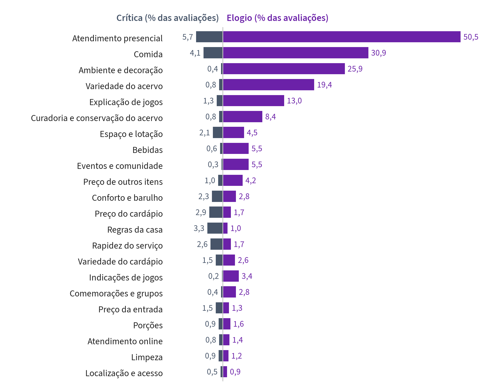

# 6 PLANO DE MARKETING

O plano de marketing define como a luderia se posiciona e se apresenta ao público de Salvador. As decisões seguem o composto de marketing: produto, preço, praça e comunicação, a partir da proposta de valor, com a estimativa de demanda ao fim.

## 6.1 PROPOSTA DE VALOR E POSICIONAMENTO

A luderia vende uma saída em grupo em que qualquer pessoa joga em poucos minutos: o instrutor escolhe o jogo pelo perfil da mesa e ensina a regra, e a cozinha serve sem parar a partida. A proposta sai do que os clientes dos concorrentes elogiam e criticam nas avaliações (Figura 6.1). O atendimento presencial aparece em 55,6% das 1.628 avaliações com texto do B2, à frente da comida (34,1%), do ambiente e decoração (26,2%) e da variedade do acervo (20,1%). A explicação de jogos, citada em 14,3%, é o serviço da equipe ligado ao acervo.

**Figura 6.1 – Temas elogiados e criticados nas avaliações dos concorrentes**

Fonte: elaborado pelo próprio autor, com base no Bloco B2 (avaliações até "3 meses atrás", coletadas de 09/10/2026 a 30/10/2026).

Nota: temas não exclusivos; uma avaliação pode elogiar e criticar vários temas. Grade de 22 temas e frequências no Apêndice F.

As críticas são raras, mas derrubam a nota. Quando o atendimento é criticado, a nota média da avaliação cai para 1,93; quando a crítica é à rapidez do serviço, para 2,50; à explicação de jogos, para 2,62 (Bloco B2). Quatro temas têm mais críticas que elogios: regras da casa (53 contra 17), preço do cardápio (48 contra 27), rapidez do serviço (42 contra 27) e preço da entrada (25 contra 21). Nas críticas às regras, as palavras mais frequentes tratam de reserva (12 das 53) e de horário (10).

A grade ERRC (eliminar, reduzir, elevar e criar) converte essas evidências em decisões diante do padrão dos concorrentes (KIM; MAUBORGNE, 2005) [AV]. A luderia elimina o que trava a entrada, reduz o que o cliente pouco cobra, eleva o serviço de mesa e cria a indicação de jogos pelo perfil do grupo (Quadro 6.1).

**Quadro 6.1 – Grade ERRC da luderia**

| Ação | Decisão | Evidência |
|---|---|---|
| Eliminar | Consumação mínima e cobrança por jogo: uma taxa por pessoa e por turno | Regras da casa com 53 críticas e 17 elogios (B2); consumação mínima no LudoCafé e cobrança por título na BoardZ (B1) |
| Reduzir | Acervo inicial de 175 títulos, contra a mediana de 322 nos 30 acervos publicados | Variedade do acervo com 13 críticas em 1.628 avaliações (B2) |
| Reduzir | Taxa de entrada de R$ 18,68, abaixo da São Jogue | Preço da entrada com 25 críticas e 21 elogios (B2); Tabela 6.1 (B1) |
| Elevar | Instrutor no salão, com no máximo 2 mesas por instrutor no pico, e explicação de regras inclusa na taxa | Explicação de jogos em 14,3% das avaliações; nota média de 2,62 quando criticada (B2) |
| Elevar | Cardápio de preparo rápido | Rapidez do serviço com 42 críticas e 27 elogios; nota média de 2,50 quando criticada (B2) |
| Criar | Indicação de jogo pelo perfil do grupo, com apoio de um site de recomendação | Indicações de jogos em 3,6% das avaliações; nota média de 1,25 nas 4 críticas (B2) |

Fonte: elaborado pelo próprio autor, com base nos Blocos B1 e B2.

O posicionamento fica entre o bar e a loja de jogos. O preço de entrada fica abaixo do da São Jogue, a cozinha é completa, e o diferencial é o serviço de mesa, que a avaliação elogia quando existe e pune quando falta.

## 6.2 PRODUTO E SERVIÇO

O produto tem três partes: a mesa com instrutor, o acervo e os alimentos e bebidas. As decisões de cada parte saem da proposta de valor; a operação está no capítulo 7. Na mesa, o grupo paga um turno de 3 horas (seção 6.3), e o instrutor sugere o jogo e explica as regras sem custo extra. A indicação e a explicação são a parte do serviço mais ligada à nota: as 4 avaliações que criticam a indicação de jogos têm nota média de 1,25.

O acervo abre com 175 títulos, os presentes em 12 ou mais dos 30 acervos publicados pelos concorrentes do B1, e cresce por gatilho (seção 7.4). A conservação pesa tanto quanto o tamanho: a curadoria e conservação do acervo aparece em 9,2% das avaliações, e 9 das 13 críticas falam de jogos gastos ou com peças faltando, o que leva à conferência de peças na devolução (seção 7.4).

Os alimentos e bebidas são a maior fonte de receita e o segundo tema das avaliações. A comida aparece em 34,1% delas, com 503 elogios e 67 críticas. O cardápio é curto e de preparo rápido, com porções para dividir na mesa: além da comida (67 críticas), as críticas de A&B recaem sobre o preço (48) e a demora (42) mais que sobre a variedade (24). Os produtos complementares são o aluguel de jogos para levar para casa, com preço da tabela da São Jogue (premissa R10), e as comemorações em grupo, citadas em 3,1% das avaliações.

## 6.3 PREÇO

A luderia cobra uma taxa de entrada por pessoa, por turno de 3 horas, com valor maior de sexta a domingo. É o modelo da São Jogue e o mais comum entre os concorrentes que divulgam a taxa: 15 dos 22 que cobram diferenciam o preço pelo dia da semana (Tabela 6.1). O turno de 3 horas fica acima da permanência média medida no B3, de 109 minutos, e não limita o grupo típico; serve para liberar a mesa nos horários de reserva. A São Jogue usa o mesmo turno de 3 horas (Tabela 6.1).

**Tabela 6.1 – Taxa de entrada por pessoa nos concorrentes que a divulgam (R$)**

| Concorrente | Capital | Dia útil | Fim de semana |
|---|---|---|---|
| Encounter | São Paulo | 35,00 | 40,00 a 45,00 |
| LudoCafé | Belo Horizonte | 10,00 a 25,00 | 20,00 a 35,00 |
| Shelf Bar e Jogos | Belo Horizonte | 15,00 a 20,00 | 30,00 |
| Tubaleria | São Paulo | 28,00 | 28,00 |
| Ludoteca Sidequest | Belém | 23,00 | 28,00 |
| São Jogue (turno de 3 h) | Salvador | 22,00 | 28,00 |
| Place Games | São Paulo | 0,00 a 25,00 | 25,00 |
| Bardo Mago | Belo Horizonte | 15,00 | 25,00 |
| Game Of Boards | Rio de Janeiro | 15,00 | 25,00 |
| Loja de Jogos - Asgard | Brasília | 10,00 | 25,00 |
| Nala Land | Recife | 20,00 | 20,00 a 25,00 |
| TabuClub | Rio de Janeiro | 20,00 | 20,00 a 25,00 |
| Arena BG | São Paulo | 0,00 | 12,50 a 25,00 |
| Fan Hour | São Paulo | 20,00 | 20,00 |
| Luderia Carioca | Rio de Janeiro | 20,00 | 20,00 |
| Comdado Bar e Jogos | Belo Horizonte | 15,00 | 20,00 |
| Covil Game Bar | São Paulo | 15,00 | 15,00 a 20,00 |
| La Tabuleria | Belo Horizonte | 10,00 | 15,00 a 20,00 |
| BoardZ Game Pub | Curitiba | 10,00 | 15,00 |
| Joyjoy Café | Curitiba | 10,00 | 10,00 a 15,00 |
| Café Geek | Vitória | 0,00 a 15,00 | 0,00 a 15,00 |
| Garagem do Nerd | Belo Horizonte | 10,00 | 10,00 |
| Toca do Rato | Porto Alegre | 5,00 | 5,00 |
| Ludus Luderia | São Paulo | 0,00 | 0,00 |

Fonte: elaborado pelo próprio autor, com base nos cardápios, sites, matérias de imprensa, posts do Instagram e fotos do Google Maps do Bloco B1 (04/2024 a 07/2026; BoardZ sem data, coletada em 10/2026) e nas NFC-e da São Jogue (Bloco B3, 10/10/2026 a 30/10/2026).

Nota: em negrito, a São Jogue, única luderia de Salvador no B1. Linhas em ordem decrescente do valor de fim de semana. Fim de semana: sexta a domingo e feriados. Faixa: menor e maior valor do período. LudoCafé: menor valor com consumo mínimo de R$ 50,00. BoardZ: passe do dia; a casa não cobra entrada, e o jogo avulso é pago por título. Place Games: R$ 10,00 da entrada valem como consumo, e a entrada é grátis na confraria de quinta. Café Geek: passaporte por nível de jogo. A taxa de entrada do plano, de R$ 18,68, é a média do couvert ou da taxa de jogo nos cardápios das 22 casas que a cobram (mediana de R$ 20,00), e não a média desta tabela, que reúne também sites, imprensa e redes sociais (seção 6.3).

A taxa da São Jogue está no alto da faixa. Pelo maior valor de cada casa, a mediana dos 22 concorrentes que cobram é de R$ 25,00 no fim de semana, e só três cobram mais que a São Jogue: Encounter (R$ 45,00 no sábado), LudoCafé (R$ 35,00 sem consumo mínimo) e Shelf (R$ 30,00). No dia útil, a mediana é de R$ 15,00, contra R$ 22,00. Dos 53 concorrentes do B1, 22 têm a taxa encontrada no cardápio, no site, na imprensa ou no Instagram, e a Ludus declara que não cobra; nos outros 30, a cobrança não foi encontrada. Os valores de Covil, LudoCafé, Garagem do Nerd e Joyjoy são de 2024 e podem estar defasados. A contagem exclui a sala privativa do Café Geek, cobrada por hora e por grupo.

As avaliações confirmam que o preço da entrada pesa, mas pouco. Das 1.628 avaliações com texto do B2, 45 citam o preço da entrada – 25 de forma negativa e 21 positiva, uma delas com as duas – e 74 citam o preço do cardápio, 48 de forma negativa. Na Sidequest, que cobra o mesmo que a São Jogue no fim de semana, um cliente chamou os R$ 28,00 de "um preço um pouco alto" e deu nota 4. O gasto declarado pelos avaliadores no campo de preço por pessoa do Google Maps tem mediana na faixa de R$ 80,00 a R$ 100,00 (352 declarações, sem a Bodogami, que soma 250 das 602; Figura 6.2).

**Figura 6.2 – Gasto por pessoa declarado pelos avaliadores no Google Maps**

Fonte: elaborado pelo próprio autor, com base no Bloco B2 (avaliações até "3 meses atrás", coletadas de 09/10/2026 a 30/10/2026).

O gasto declarado confirma a cesta de consumo dos cardápios. A cesta de cada concorrente soma a mediana das bebidas, a mediana das entradas ou pratos principais e a taxa de entrada. Quando a taxa muda com o dia, entra a média das taxas, ponderada pelos dias em que cada uma vale. Nos 12 concorrentes com taxa conhecida e gasto declarado, a cesta média é de R$ 79,20, e o gasto médio declarado, de R$ 80,14 por pessoa (675 declarações; Blocos B1 e B2). Cada pessoa gasta, em média, uma cesta de consumo. Num grupo de 3,6 pessoas, a visita custa R$ 288,50. Na Bahia, as famílias com renda de R$ 5.724,00 a R$ 9.540,00 gastavam R$ 448,65 por mês com alimentação fora do domicílio (IBGE, POF 2017-2018), ou R$ 694,55 a preços de agosto de 2026, corrigidos pelo IPCA (BCB, SGS): uma visita consome 42% desse orçamento. A luderia é ocasião de saída, não hábito semanal.

O plano adota como taxa de entrada a média dos concorrentes que a cobram: R$ 18,68 por pessoa, em todos os dias. O valor fica perto da mediana dos concorrentes (R$ 20,00) e abaixo da São Jogue (R$ 28,00 no fim de semana e R$ 22,00 no dia útil). No modelo, a receita por pessoa segue o gasto declarado: R$ 80,14 no provável, o gasto do concorrente de menor gasto (R$ 40,00) no pessimista e o do de maior gasto (R$ 109,84) no otimista. Os valores entram no registro de premissas do capítulo 9 como R06 e R07. Com a entrada mais barata que a da São Jogue, o preço atrai o cliente da concorrente, e o serviço de mesa – explicação de jogos e acervo grande – sustenta a volta, o que liga o preço à proposta de valor (seção 6.1).

## 6.4 PRAÇA

A Pituba é o bairro indicado para a luderia. Ela lidera a matriz de critérios em todos os conjuntos de pesos testados (Tabela 6.2): tem a 5ª maior população de 20 a 39 anos de Salvador, 15.276 pessoas, e 95,1% dos domicílios em apartamento (IBGE, Censo 2022). A matriz precisa de uma medida de renda que o Censo 2022 não oferece, já que ele não publica renda por bairro. A proporção de domicílios em apartamento entra como substituta da renda: em Salvador, a média é de 28,1%, e só 19 dos 170 bairros passam de 80%. A substituição tem limite: conjuntos habitacionais também são apartamentos, e Cajazeiras II (90,9%) é o exemplo. A matriz considera só os bairros com pelo menos 80% de apartamentos e 3.500 pessoas de 20 a 39 anos – 10 dos 170 bairros.

**Tabela 6.2 – Matriz de critérios ponderados para o bairro, Salvador**

| Posição | Bairro | Pessoas de 20 a 39 anos | Domicílios em apartamento (%) | Pessoas de 20 a 39 anos por km² | Nota (0 a 1) |
|---|---|---|---|---|---|
| 1 | Pituba | 15.276 | 95,1 | 3.353 | 0,864 |
| 2 | Graça | 3.756 | 97,2 | 4.380 | 0,473 |
| 3 | Imbuí | 9.127 | 88,3 | 3.431 | 0,437 |
| 4 | Vila Laura | 4.070 | 93,0 | 4.861 | 0,412 |
| 5 | Costa Azul | 4.996 | 92,6 | 3.857 | 0,386 |
| 6 | Caminho das Árvores | 4.037 | 93,8 | 2.013 | 0,270 |
| 7 | Jardim das Margaridas | 7.018 | 84,8 | 2.744 | 0,222 |
| 8 | Barra | 3.862 | 89,5 | 2.742 | 0,199 |
| 9 | Patamares | 5.969 | 88,7 | 1.307 | 0,190 |
| 10 | STIEP | 4.034 | 86,6 | 3.265 | 0,166 |

Fonte: elaborado pelo próprio autor, com base no IBGE (Censo 2022, agregados por bairro).

Nota: pesos de 50% para o público de 20 a 39 anos, 30% para os domicílios em apartamento e 20% para o público por km²; cada critério normalizado de 0 a 1 entre os candidatos. Com pesos de 40%, 40% e 20%, de 60%, 20% e 20% ou iguais, a Pituba segue em 1º.

Os pesos são do autor (N6) e não mudam a escolha (nota da Tabela 6.2): Graça, Imbuí e Vila Laura só alternam do 2º ao 5º lugar. Nenhuma das duas unidades da São Jogue está entre os candidatos: a Bela Vista fica no Shopping Bela Vista, em Pernambués, e a Paralela, no Shopping Paralela.

Escolhido o bairro, falta definir o ponto. Ele deve ficar a até 1.000 m de uma estação de metrô. Entre os 54 concorrentes do B1, os 24 com estação a até 1.000 m têm mediana de 770 avaliações no Google Maps, contra 396 dos 30 sem estação (Bloco B1, entorno pelo Google Maps). O shopping de porte não mostra a mesma vantagem: os 10 concorrentes com shopping a até 1.000 m têm mediana de 396 avaliações, contra 663 dos 19 sem (25 sem dado). O número de avaliações mede fluxo de forma indireta, e a associação não prova causa. A São Jogue da Bela Vista, único concorrente de Salvador no B1 (787 avaliações), fica dentro do Shopping Bela Vista, a 387 m do metrô.

Falta o custo do ponto por bairro. O FipeZap dá o aluguel comercial só para Salvador inteira (R$ 54,15 por m² em jul/2026), sem recorte de bairro; o capítulo 9 usa esse valor, e o pessimista (R$ 64,36) cobre parte do prêmio de um bairro como a Pituba. A cotação de pontos na Pituba, junto ao metrô, fecha a decisão [BUSCAR – anúncios de locação comercial].

## 6.5 PROMOÇÃO E COMUNICAÇÃO

O Google Maps é o canal principal, e o Instagram, o de apoio. Entre os 49 concorrentes com perfil medido, os que têm mais seguidores no Instagram também têm mais avaliações no Google Maps (correlação de Spearman de 0,62), mas o número de posts no mês não acompanha as avaliações (0,15; posts de 01/09/2026 a 01/10/2026). A mediana é de 14.021 seguidores e 12 posts no mês; a São Jogue tem 38.492 seguidores e publicou 26 vezes (Bloco B1). A luderia não precisa publicar mais que os concorrentes. Precisa de clientes que avaliem e de um perfil que mostre a mesa e o instrutor.

A mensagem fala com grupos de amigos e com quem organiza aniversários. Quando a avaliação diz com quem o cliente foi, os amigos aparecem em 56 avaliações, a família em 40, o aniversário em 39 e o casal em 13 (Bloco B2). O dado é exploratório (seção 3.3), mas confirma a ocasião em grupo do capítulo 5. O argumento é a proposta de valor: ninguém precisa conhecer o jogo, porque o instrutor ensina.

O orçamento de marketing é de R$ 1.500,00 por mês no provável, de R$ 1.000,00 a R$ 2.000,00 nos cenários (premissa C10). O valor é estimativa do autor (N6): o escopo não inclui teste de anúncio, e o custo de aquisição de cliente não foi medido. No mês maduro do provável, o orçamento equivale a R$ 1,59 por visita (seção 6.6). Três indicadores acompanham o plano: a nota no Google Maps, com meta de 4,7, a mediana dos concorrentes; a proporção de avaliações que criticam o atendimento, de 5,7% nos concorrentes (B2); e a circulação no pico de fim de semana, que precisa ficar acima de 4,91 pessoas por hora, o ponto de ruptura da seção 9.5.

## 6.6 ESTIMATIVA DE DEMANDA

A luderia deve receber 942 pessoas por mês no ano maduro do cenário provável, de 594 a 1.720 nos cenários (Tabela 6.3). A estimativa parte da *circulação*: as pessoas que entram na luderia por hora. A circulação no pico vem da contagem direta na São Jogue (B3), nas noites de sexta e sábado: 6,40 pessoas por hora, em média. O pico não dura o dia inteiro. Para levar a circulação ao dia, o modelo usa o horário dos 54 concorrentes (B1): em cada hora aberta do plano, o número de concorrentes abertos é dividido pelo número de concorrentes abertos nas horas das visitas. A soma dessas razões dá as horas de pico equivalentes do dia: 6,84 horas, em média, de sexta a domingo, nas 8 horas abertas. No mês maduro do cenário provável, a conta é a seguinte:

pessoas por dia de fim de semana = circulação no pico × horas de pico equivalentes (1)

6,40 × 6,84 = 43,8 pessoas por dia de fim de semana

O dia útil (terça a quinta) entra em separado do fim de semana (sexta a domingo), porque o movimento é menor. Em restaurantes de loja física, um dia de segunda a quinta recebe 61,9% do gasto de um dia de sexta a domingo no Rio de Janeiro e 69,2% em São Paulo (ANR, 2026a; 2026b). Com a média das duas cidades, 65,5%, o dia útil recebe 28,7 pessoas. Com 3 dias de cada tipo por semana e 4,33 semanas por mês, o mês maduro soma 942 pessoas.

**Tabela 6.3 – Demanda no mês maduro, por cenário**

| Variável | Pessimista | Provável | Otimista |
|---|---|---|---|
| Circulação no pico de fim de semana (pessoas por hora) | 4,13 | 6,40 | 11,43 |
| Dia útil (% do fim de semana) | 61,9 | 65,5 | 69,2 |
| Pessoas por dia de fim de semana | 28,2 | 43,8 | 78,2 |
| Pessoas por dia útil | 17,5 | 28,7 | 54,1 |
| Pessoas por mês | 594 | 942 | 1.720 |

Fonte: elaborado pelo próprio autor, com base nos Blocos B1 e B3 e na ANR (2026a; 2026b), no modelo financeiro (Apêndice E).

Nota: pessimista com o piso das notas fiscais da São Jogue e a razão do Rio de Janeiro; otimista com a visita mais cheia e a razão de São Paulo. Horas de pico equivalentes de 6,84 nos três cenários.

O primeiro ano tem rampa: o movimento começa em 40% do maduro e chega a 100% no mês 9, de 30% em 12 meses no pessimista a 50% em 6 meses no otimista (premissas R11 e R12, estimativa do autor, N6). O caminho inverso confere a ordem de grandeza. As 11,3 mil visitas por ano do provável equivalem a 1,4 visita por ano para cada 100 moradores de Salvador de 20 a 39 anos, cerca de 781 mil pessoas se mantida a proporção do Censo 2022 (IBGE). A luderia não precisa criar um mercado novo para atingir o provável.

**Referências citadas neste capítulo**

ASSOCIAÇÃO NACIONAL DE RESTAURANTES (ANR). *Panorama do consumo em restaurantes no Rio de Janeiro*: preferências por cozinha, dias da semana e momentos de refeição. São Paulo, 10 set. 2026a. Estudo do Mastercard Economics Institute em parceria com a ANR. Disponível em: https://anrbrasil.org.br/panorama-do-consumo-em-restaurantes-no-rio-de-janeiro-preferencias-por-cozinha-dias-da-semana-e-momentos-de-refeicao/. Acesso em: 2 nov. 2026.

ASSOCIAÇÃO NACIONAL DE RESTAURANTES (ANR). *Calor e chuva esfriam o apetite?* Estudo inédito da Mastercard Economics Institute em parceria com a ANR revela o impacto do clima sobre os gastos em restaurantes de São Paulo. São Paulo, 11 ago. 2026b. Disponível em: https://anrbrasil.org.br/calor-e-chuva-esfriam-o-apetite-estudo-inedito-da-mastercard-economics-institute-em-parceria-com-a-anr-revela-o-impacto-do-clima-sobre-os-gastos-em-restaurantes-de-sao-paulo/. Acesso em: 2 nov. 2026.

BANCO CENTRAL DO BRASIL (BCB). *Relatório Focus*: expectativas de mercado de 11 set. 2026. Brasília, 2026. Disponível em: https://www.bcb.gov.br/content/focus/focus/R20260911.pdf. Acesso em: 2 nov. 2026.

BANCO CENTRAL DO BRASIL (BCB). *Sistema Gerenciador de Séries Temporais (SGS)*: séries 432, 433, 1619 e 13522. Brasília, 2026. Disponível em: https://www3.bcb.gov.br/sgspub/. Acesso em: 14 out. 2026.

FUNDAÇÃO INSTITUTO DE PESQUISAS ECONÔMICAS (FIPE). *Índice FipeZAP*: locação comercial, julho de 2026. São Paulo, 2026. Disponível em: https://downloads.fipe.org.br/indices/fipezap/fipezap-202607-comercial.pdf. Acesso em: 2 nov. 2026.

IBGE. *Censo Demográfico 2022*: população residente por idade. Rio de Janeiro: IBGE, 2023. Disponível em: https://sidra.ibge.gov.br/tabela/9514. Acesso em: 2 nov. 2026. `[AV ano]`

IBGE. *Estimativas da população residente*: 2026. Rio de Janeiro: IBGE, 2026. Disponível em: https://www.ibge.gov.br/estatisticas/sociais/populacao/9103-estimativas-de-populacao.html. Acesso em: 2 nov. 2026.

IBGE. *Pesquisa Anual de Serviços (PAS)*: tabelas 2611, 2619 e 10758. Rio de Janeiro: IBGE, 2025-2026. Disponível em: https://sidra.ibge.gov.br/tabela/2611, https://sidra.ibge.gov.br/tabela/2619 e https://sidra.ibge.gov.br/tabela/10758. Acesso em: 2 nov. 2026. `[AV ano de cada edição]`

IBGE. *Pesquisa de Orçamentos Familiares 2017-2018*: perfil das despesas no Brasil: indicadores selecionados de alimentação, transporte, lazer e inclusão financeira. Rio de Janeiro: IBGE, 2021. Disponível em: https://biblioteca.ibge.gov.br/visualizacao/livros/liv101844.pdf. Acesso em: 2 nov. 2026.

IBGE. *Pesquisa de Orçamentos Familiares 2017-2018*: tabelas 6715 e 6972. Rio de Janeiro: IBGE, 2019. Disponível em: https://sidra.ibge.gov.br/tabela/6715 e https://sidra.ibge.gov.br/tabela/6972. Acesso em: 2 nov. 2026.

IBGE. *Pesquisa Nacional por Amostra de Domicílios Contínua*: tabelas 5436 e 7395. Rio de Janeiro: IBGE, 2026. Disponível em: https://sidra.ibge.gov.br/tabela/5436 e https://sidra.ibge.gov.br/tabela/7395. Acesso em: 2 nov. 2026.

IBGE. *Regiões de influência das cidades 2018*. Rio de Janeiro: IBGE, 2020. Disponível em: https://biblioteca.ibge.gov.br/visualizacao/livros/liv101728.pdf. Acesso em: 2 nov. 2026.

IBGE. *Sistema Nacional de Índices de Preços ao Consumidor*: IPCA, tabela 7060. Rio de Janeiro: IBGE, 2026. Disponível em: https://sidra.ibge.gov.br/tabela/7060. Acesso em: 2 nov. 2026.

KIM, W. Chan; MAUBORGNE, Renée. *A estratégia do oceano azul*: como criar novos mercados e tornar a concorrência irrelevante. Rio de Janeiro: Elsevier, 2005. [AV]
