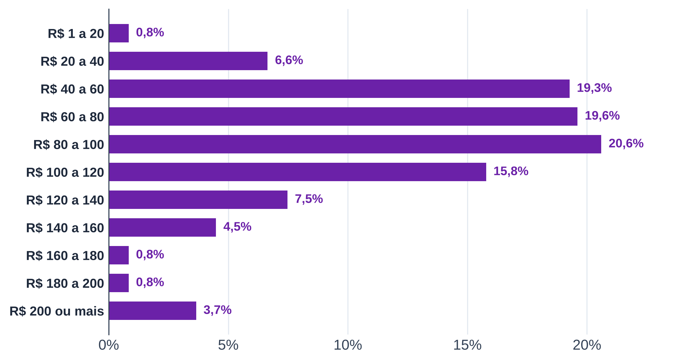

# 6 PLANO DE MARKETING

> **Rascunho parcial (31/10/2026).** Só as seções 6.3 e 6.4; as demais ficam para depois do Bardin (6.1, 6.2, 6.5) e da calibração da demanda (seção 6.6). Números de preço do B1 (cardápios; couvert também de site, imprensa e Instagram, atualizado em 31/10/2026), B2 (avaliações até "3 meses atrás", no Notion "2 - Comentários" em 31/10/2026) e B3 (contagem direta); números de praça do Censo 2022 (`B4-a_matriz_bairros.py`) e do entorno do B1.

O plano de marketing define como a luderia se posiciona e se apresenta ao público de Salvador. As decisões seguem o composto de marketing: preço, praça e comunicação, a partir da proposta de valor, com a estimativa de demanda ao fim.

## 6.3 PREÇO

A luderia cobra uma taxa de entrada por pessoa, por turno de 3 horas, com valor maior de sexta a domingo. É o modelo da São Jogue e o mais comum entre os concorrentes que divulgam a taxa: 15 dos 22 que cobram diferenciam o preço pelo dia da semana (Tabela 6.1). O turno de 3 horas fica acima da permanência média medida no B3, de 109 minutos, e não limita o grupo típico; serve para liberar a mesa nos horários de reserva. A São Jogue usa o mesmo turno de 3 horas (Tabela 6.1).

**Tabela 6.1 – Taxa de entrada por pessoa nos concorrentes que a divulgam (R$)**

| Concorrente | Capital | Dia útil | Fim de semana |
|---|---|---|---|
| Encounter | São Paulo | 35,00 | 40,00 a 45,00 |
| LudoCafé | Belo Horizonte | 10,00 a 25,00 | 20,00 a 35,00 |
| Shelf Bar e Jogos | Belo Horizonte | 15,00 a 20,00 | 30,00 |
| Tubaleria | São Paulo | 28,00 | 28,00 |
| Ludoteca Sidequest | Belém | 23,00 | 28,00 |
| São Jogue (turno de 3 h) | Salvador | 22,00 | 28,00 |
| Place Games | São Paulo | 0,00 a 25,00 | 25,00 |
| Bardo Mago | Belo Horizonte | 15,00 | 25,00 |
| Game Of Boards | Rio de Janeiro | 15,00 | 25,00 |
| Loja de Jogos - Asgard | Brasília | 10,00 | 25,00 |
| Nala Land | Recife | 20,00 | 20,00 a 25,00 |
| TabuClub | Rio de Janeiro | 20,00 | 20,00 a 25,00 |
| Arena BG | São Paulo | 0,00 | 12,50 a 25,00 |
| Fan Hour | São Paulo | 20,00 | 20,00 |
| Luderia Carioca | Rio de Janeiro | 20,00 | 20,00 |
| Comdado Bar e Jogos | Belo Horizonte | 15,00 | 20,00 |
| Covil Game Bar | São Paulo | 15,00 | 15,00 a 20,00 |
| La Tabuleria | Belo Horizonte | 10,00 | 15,00 a 20,00 |
| BoardZ Game Pub | Curitiba | 10,00 | 15,00 |
| Joyjoy Café | Curitiba | 10,00 | 10,00 a 15,00 |
| Café Geek | Vitória | 0,00 a 15,00 | 0,00 a 15,00 |
| Garagem do Nerd | Belo Horizonte | 10,00 | 10,00 |
| Toca do Rato | Porto Alegre | 5,00 | 5,00 |
| Ludus Luderia | São Paulo | 0,00 | 0,00 |

Fonte: elaboração própria, com base nos cardápios, sites, matérias de imprensa, posts do Instagram e fotos do Google Maps do Bloco B1 (04/2024 a 07/2026; BoardZ sem data, coletada em 10/2026) e nas NFC-e da São Jogue (Bloco B3, 10/10/2026 a 30/10/2026).

Nota: em negrito, a São Jogue, única luderia de Salvador no B1. Linhas em ordem decrescente do valor de fim de semana. Fim de semana: sexta a domingo e feriados. Faixa: menor e maior valor do período. LudoCafé: menor valor com consumo mínimo de R$ 50,00. BoardZ: passe do dia; a casa não cobra entrada, e o jogo avulso é pago por título. Place Games: R$ 10,00 da entrada valem como consumo, e a entrada é grátis na confraria de quinta. Café Geek: passaporte por nível de jogo. A taxa de entrada do plano, de R$ 18,68, é a média do couvert ou da taxa de jogo nos cardápios das 22 casas que a cobram (mediana de R$ 20,00), e não a média desta tabela, que reúne também sites, imprensa e redes sociais (seção 6.3).

A taxa da São Jogue está no alto da faixa. Pelo maior valor de cada casa, a mediana dos 22 concorrentes que cobram é de R$ 25,00 no fim de semana, e só três cobram mais que a São Jogue: Encounter (R$ 45,00 no sábado), LudoCafé (R$ 35,00 sem consumo mínimo) e Shelf (R$ 30,00). No dia útil, a mediana é de R$ 15,00, contra R$ 22,00. Dos 53 concorrentes do B1, 22 têm a taxa encontrada no cardápio, no site, na imprensa ou no Instagram, e a Ludus declara que não cobra; nos outros 30, a cobrança não foi encontrada. Os valores de Covil, LudoCafé, Garagem do Nerd e Joyjoy são de 2024 e podem estar defasados. A contagem exclui a sala privativa do Café Geek, cobrada por hora e por grupo.

As avaliações confirmam que o preço da entrada pesa, mas pouco. Das 1.628 avaliações com texto do B2, 44 citam a taxa de entrada — 24 de forma negativa e 20 positiva — e 152 citam o preço do consumo, 61 de forma negativa. Na Sidequest, que cobra o mesmo que a São Jogue no fim de semana, um cliente chamou os R$ 28,00 de "um preço um pouco alto" e deu nota 4. O gasto declarado pelos avaliadores no campo de preço por pessoa do Google Maps tem mediana na faixa de R$ 80,00 a R$ 100,00 (352 declarações, sem a Bodogami, que soma 250 das 602; Figura 6.1).

**Figura 6.1 – Gasto por pessoa declarado pelos avaliadores no Google Maps**

Fonte: elaboração própria, com base no Bloco B2 (avaliações até "3 meses atrás", coletadas de 09/10/2026 a 30/10/2026).

Pelos cardápios, uma visita custa de R$ 44,09 a R$ 69,50 por pessoa. A taxa de entrada média é de R$ 18,68, nas 22 casas que a cobram, e a cesta de consumo, uma bebida e uma entrada ou prato, custa em média R$ 50,82, em 36 casas (Bloco B1). O valor menor supõe uma cesta dividida por dupla; o maior, uma cesta por pessoa. Num grupo de 3,6 pessoas, a visita custa de R$ 158,72 a R$ 250,20. Na Bahia, as famílias com renda de R$ 5.724,00 a R$ 9.540,00 gastavam R$ 448,65 por mês com alimentação fora do domicílio (IBGE, POF 2017-2018), ou R$ 694,55 a preços de agosto de 2026, corrigidos pelo IPCA (BCB, SGS): uma visita consome de 23% a 36% desse orçamento. A luderia é ocasião de saída, não hábito semanal.

O plano adota como taxa de entrada a média dos concorrentes que a cobram: R$ 18,68 por pessoa, em todos os dias e nos três cenários. O valor fica perto da mediana dos concorrentes (R$ 20,00) e abaixo da São Jogue (R$ 28,00 no fim de semana e R$ 22,00 no dia útil). O consumo segue a cesta média dos cardápios, R$ 50,82, dividida por uma, duas ou três pessoas nos cenários otimista, provável e pessimista. Os valores entram no registro de premissas do cap. 9 como R06, R07 e R08. Com a entrada mais barata que a da São Jogue, o preço atrai o cliente da concorrente, e o serviço de mesa — explicação de jogos e acervo grande — sustenta a volta, o que liga o preço à proposta de valor (seção 6.1).

## 6.4 PRAÇA

A Pituba é o bairro indicado para a luderia. Ela lidera a matriz de critérios em todos os conjuntos de pesos testados (Tabela 6.2): tem a 5ª maior população de 20 a 39 anos de Salvador, 15.276 pessoas, e 95,1% dos domicílios em apartamento (IBGE, Censo 2022). A matriz precisa de uma medida de renda que o Censo 2022 não oferece, já que ele não publica renda por bairro. A proporção de domicílios em apartamento entra como substituta da renda: em Salvador, a média é de 28,1%, e só 19 dos 170 bairros passam de 80%. A substituição tem limite: conjuntos habitacionais também são apartamentos, e Cajazeiras II (90,9%) é o exemplo. A matriz considera só os bairros com pelo menos 80% de apartamentos e 3.500 pessoas de 20 a 39 anos — 10 dos 170 bairros.

**Tabela 6.2 – Matriz de critérios ponderados para o bairro, Salvador**

| Posição | Bairro | Pessoas de 20 a 39 anos | Domicílios em apartamento (%) | Pessoas de 20 a 39 anos por km² | Nota (0 a 1) |
|---|---|---|---|---|---|
| 1 | Pituba | 15.276 | 95,1 | 3.353 | 0,864 |
| 2 | Graça | 3.756 | 97,2 | 4.380 | 0,473 |
| 3 | Imbuí | 9.127 | 88,3 | 3.431 | 0,437 |
| 4 | Vila Laura | 4.070 | 93,0 | 4.861 | 0,412 |
| 5 | Costa Azul | 4.996 | 92,6 | 3.857 | 0,386 |
| 6 | Caminho das Árvores | 4.037 | 93,8 | 2.013 | 0,270 |
| 7 | Jardim das Margaridas | 7.018 | 84,8 | 2.744 | 0,222 |
| 8 | Barra | 3.862 | 89,5 | 2.742 | 0,199 |
| 9 | Patamares | 5.969 | 88,7 | 1.307 | 0,190 |
| 10 | STIEP | 4.034 | 86,6 | 3.265 | 0,166 |

Fonte: elaboração própria, com base no IBGE (Censo 2022, agregados por bairro).

Nota: pesos de 50% para o público de 20 a 39 anos, 30% para os domicílios em apartamento e 20% para o público por km²; cada critério normalizado de 0 a 1 entre os candidatos. Com pesos de 40%, 40% e 20%, de 60%, 20% e 20% ou iguais, a Pituba segue em 1º.

Os pesos são do autor (N6) e não mudam a escolha. Com pesos de 40%, 40% e 20%, de 60%, 20% e 20% ou iguais, a Pituba fica em 1º; Graça, Imbuí e Vila Laura alternam do 2º ao 5º lugar. Nenhuma das duas unidades da São Jogue está entre os candidatos: a Bela Vista fica no Shopping Bela Vista, em Pernambués, e a Paralela, no Shopping Paralela.

Escolhido o bairro, falta definir o ponto. Ele deve ficar a até 1.000 m de uma estação de metrô. Entre os 54 concorrentes do B1, os 24 com estação a até 1.000 m têm mediana de 770 avaliações no Google Maps, contra 396 dos 30 sem estação (Bloco B1, entorno pelo Google Maps). O shopping de porte não mostra a mesma vantagem: os 10 concorrentes com shopping a até 1.000 m têm mediana de 396 avaliações, contra 663 dos 19 sem (25 sem dado). O número de avaliações mede fluxo de forma indireta, e a associação não prova causa. A São Jogue da Bela Vista, único concorrente de Salvador no B1 (787 avaliações), fica dentro do Shopping Bela Vista, a 387 m do metrô.

Falta o custo do ponto por bairro. O FipeZap dá o aluguel comercial só para Salvador inteira (R$ 54,15 por m² em jul/2026), sem recorte de bairro; o cap. 9 usa esse valor, e o pessimista (R$ 64,36) cobre parte do prêmio de um bairro como a Pituba. A cotação de pontos na Pituba, junto ao metrô, fecha a decisão [BUSCAR — anúncios de locação comercial].

**Referências citadas neste capítulo**

BANCO CENTRAL DO BRASIL (BCB). *Sistema Gerenciador de Séries Temporais (SGS)*: séries 432, 433, 1619 e 13522. Brasília, 2026. Disponível em: https://www3.bcb.gov.br/sgspub/. Acesso em: 14 out. 2026.

FUNDAÇÃO INSTITUTO DE PESQUISAS ECONÔMICAS (FIPE). *Índice FipeZAP*: locação comercial, julho de 2026. São Paulo, 2026. Disponível em: https://downloads.fipe.org.br/indices/fipezap/fipezap-202607-comercial.pdf. Acesso em: 2 nov. 2026.

IBGE. *Censo Demográfico 2022*: população residente por idade. Rio de Janeiro: IBGE, 2023. Disponível em: https://sidra.ibge.gov.br/tabela/9514. Acesso em: 2 nov. 2026. `[AV ano]`

IBGE. *Estimativas da população residente*: 2026. Rio de Janeiro: IBGE, 2026. Disponível em: https://www.ibge.gov.br/estatisticas/sociais/populacao/9103-estimativas-de-populacao.html. Acesso em: 2 nov. 2026.

IBGE. *Pesquisa Anual de Serviços (PAS)*: tabelas 2611, 2619 e 10758. Rio de Janeiro: IBGE, 2025-2026. Disponível em: https://sidra.ibge.gov.br/tabela/2611, https://sidra.ibge.gov.br/tabela/2619 e https://sidra.ibge.gov.br/tabela/10758. Acesso em: 2 nov. 2026. `[AV ano de cada edição]`

IBGE. *Pesquisa de Orçamentos Familiares 2017-2018*: perfil das despesas no Brasil: indicadores selecionados de alimentação, transporte, lazer e inclusão financeira. Rio de Janeiro: IBGE, 2021. Disponível em: https://biblioteca.ibge.gov.br/visualizacao/livros/liv101844.pdf. Acesso em: 2 nov. 2026.

IBGE. *Pesquisa de Orçamentos Familiares 2017-2018*: tabelas 6715 e 6972. Rio de Janeiro: IBGE, 2019. Disponível em: https://sidra.ibge.gov.br/tabela/6715 e https://sidra.ibge.gov.br/tabela/6972. Acesso em: 2 nov. 2026.

IBGE. *Pesquisa Nacional por Amostra de Domicílios Contínua*: tabelas 5436 e 7395. Rio de Janeiro: IBGE, 2026. Disponível em: https://sidra.ibge.gov.br/tabela/5436 e https://sidra.ibge.gov.br/tabela/7395. Acesso em: 2 nov. 2026.

IBGE. *Regiões de influência das cidades 2018*. Rio de Janeiro: IBGE, 2020. Disponível em: https://biblioteca.ibge.gov.br/visualizacao/livros/liv101728.pdf. Acesso em: 2 nov. 2026.

IBGE. *Sistema Nacional de Índices de Preços ao Consumidor*: IPCA, tabela 7060. Rio de Janeiro: IBGE, 2026. Disponível em: https://sidra.ibge.gov.br/tabela/7060. Acesso em: 2 nov. 2026.
