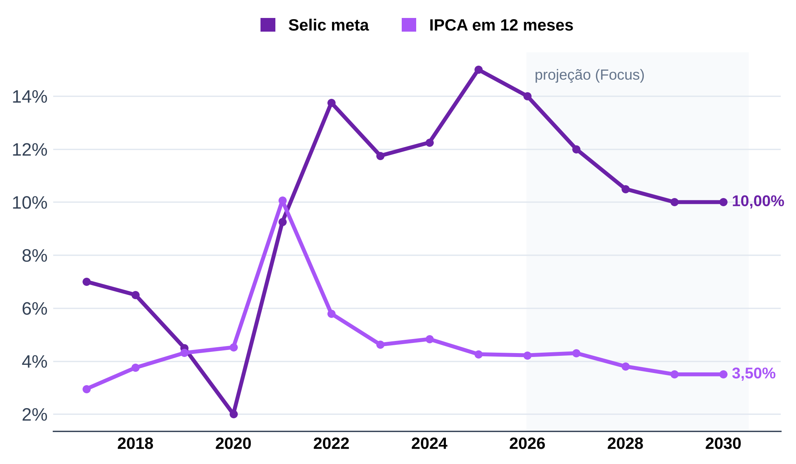
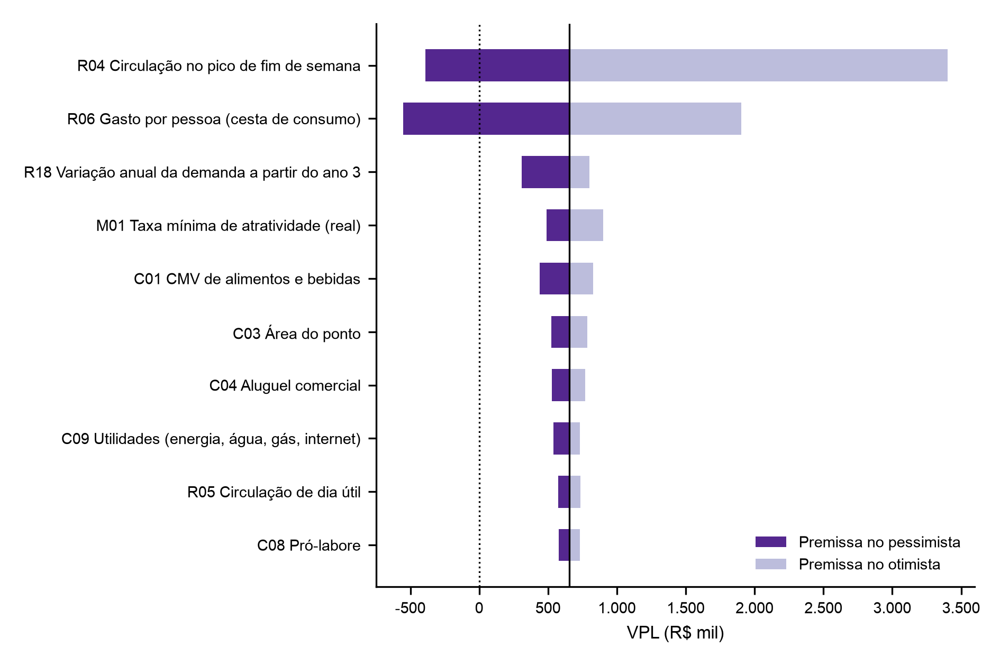

# 9 PLANO FINANCEIRO

O plano financeiro converte as decisões dos capítulos 5 a 8 em receitas, custos e indicadores de viabilidade. O capítulo parte da estrutura do modelo e do registro de premissas, projeta investimento, resultado e fluxo de caixa e termina na sensibilidade e nas checagens de coerência.

## 9.1 ÁRVORE DE DIRECIONADORES

A receita da luderia depende de três grandezas físicas e de dois preços. As pessoas atendidas saem das mesas ocupadas, das pessoas por mesa e dos giros por dia, e a receita sai dessas pessoas multiplicadas pela taxa de entrada e pelo consumo de alimentos e bebidas (A&B). O consumo por pessoa é a cesta de consumo, uma bebida e uma entrada ou prato, dividida pelas pessoas que a compartilham. As mesas ocupadas se separam em fim de semana (sexta a domingo) e dia útil (segunda a quinta). Cada folha da árvore corresponde a uma linha do registro de premissas (Quadro 9.1).

**Quadro 9.1 – Árvore de direcionadores do modelo financeiro**

| Direcionador | Cálculo | Premissas |
|---|---|---|
| Pessoas por mês | mesas ocupadas × pessoas por mesa × giros por dia × dias abertos × fator de rampa × semanas por mês, em separado para fim de semana e dia útil | R02, R04, R05, R11, R12, R15 a R17, M02 |
| Receita de taxa de entrada | pessoas × taxa de entrada | R06 |
| Receita de A&B | pessoas × cesta de consumo ÷ pessoas por cesta | R07, R08 |
| Receita de aluguel de jogos | aluguéis por mês × preço médio × fator de rampa | R09, R10 |
| Custos variáveis | Simples Nacional sobre a receita; CMV sobre o A&B; taxa de cartão | C01, C02, aba simples |
| Custos fixos | aluguel e condomínio; pessoal com encargos; pró-labore; utilidades; marketing; contabilidade; sistemas; reposição do acervo | C03 a C13 |
| Investimento | reforma; mobiliário; cozinha e bar; caixa; acervo; pré-operacional; caução; capital de giro | I01 a I08 |

Fonte: elaboração própria.

As mesas do salão (R01), a permanência (R03) e o horário (R13 e R14) não entram na receita: conferem se as mesas ocupadas e os giros cabem no salão e no horário (9.8).

O modelo usa preços constantes de outubro de 2026 e taxa mínima de atratividade (TMA) real. A projeção é mensal nos 60 meses, para capturar a rampa do ano 1, e anual nos demonstrativos.

## 9.2 REGISTRO DE PREMISSAS

O modelo tem 40 premissas, cada uma com faixa pessimista, provável e otimista, fonte e nível de evidência (Apêndice `[letra]`). O Quadro 9.2 traz as que movem o VPL em mais de R$ 100 mil entre os extremos da faixa.

**Quadro 9.2 – Premissas de maior impacto no VPL**

| ID | Premissa | Pessimista | Provável | Otimista | Fonte | Nível |
|---|---|---|---|---|---|---|
| R02 | Pessoas por mesa ocupada | 2,5 | 3,6 | 5,5 | B3, 4 visitas; faixa do autor | N5 + N6 |
| R04 | Mesas ocupadas em média, fim de semana | 2,71 | 4,37 | 6,04 | B3, 4 visitas | N5 |
| R08 | Pessoas por cesta de consumo | 3 | 2 | 1 | Decisão do autor | N6 |
| R15 | Giros por mesa por dia | 3,61 | 4,56 | 5,51 | B3, NFC-e e permanência | N5 |
| C06 | Quadro de pessoal (pessoas) | 14 | 12 | 10 | CAGED (salários); autor (quadro) | N2 + N6 |
| R05 | Mesas ocupadas em dia útil (% do fim de semana) | 40% | 50% | 60% | Estimativa do autor | N6 |
| C03 | Área do ponto (m²) | 220 | 180 | 150 | Estimativa do autor | N6 |
| C04 | Aluguel comercial (R$/m² ao mês) | 64,35 | 54,15 | 45,00 | FipeZap, Salvador, jul/2026 | N2 |
| I01 | Reforma (R$/m²) | 1.400,00 | 1.000,00 | 600,00 | Estimativa do autor | N6 |
| C01 | CMV de A&B | 35% | 30% | 26% | IBGE, PAS 2023 | N2 |
| C07 | Encargos sobre a folha | 45% | 37% | 30% | CLT; estimativa do autor | N1 + N6 |
| C09 | Utilidades (R$ por mês) | 6.000,00 | 4.500,00 | 3.500,00 | Estimativa do autor | N6 |

Fonte: elaboração própria, com dados dos Blocos B1, B3 e B4 (out/2026).

As premissas de demanda vêm da contagem direta na São Jogue (B3). Nas quatro noites, os grupos tiveram 3,6 pessoas em média, a permanência média foi de 109 minutos, e 4,37 mesas ficaram ocupadas em média, de 2,69 a 6,02 por visita. A faixa das mesas ocupadas vai 38% para cada lado: é a distância média dos extremos observados até a média. As mesas ocupadas em dia útil são estimativa do autor (N6), em cerca de metade das do fim de semana, porque não houve visita em dia útil.

Os giros partem de dois limites medidos. O pessimista, de 3,61 grupos por mesa ocupada por dia, faz o cenário pessimista atender 16,1 clientes por dia, as NFC-e emitidas por dia na Paralela; como cada cliente recebe uma nota, mas a nota só sai a pedido, esse número é piso (9.7.1). O otimista, de 5,51, divide as 10 horas abertas por dia, das 12h às 22h, pela permanência média de 109 minutos. O provável fica na média dos dois: 4,56.

Os preços vêm dos cardápios dos concorrentes (6.3). A taxa de entrada é a média das 22 casas que a cobram, R$ 18,68 por pessoa, em todos os dias. O consumo parte da cesta média de 36 casas, R$ 50,82, dividida por três pessoas no pessimista, duas no provável e uma no otimista: de R$ 16,94 a R$ 50,82 por pessoa. Taxa e cesta são iguais nos três cenários; a variação do consumo entra pelas pessoas por cesta.

Do lado dos custos, o modelo usa bases públicas sempre que possível: o aluguel do FipeZap, os salários das medianas de admissão em Salvador no Novo CAGED, quase todas no piso de R$ 1.625,09, e o CMV de 30% da PAS 2023. Área, reforma, mobiliário, cozinha e despesas gerais não têm cotação e ficam em N6.

Falta a taxa que desconta esses fluxos. A TMA real provável é de 15% ao ano. A Selic meta de 14,0% (BCB, set/2026), descontado o IPCA esperado de 4,3% para 2027 (Focus), dá juro real de 9,3%, somado a um prêmio de 3 a 9 pontos percentuais pelo risco de pequeno negócio novo. A curva do Focus prevê queda da Selic até 2029 (Figura 9.1), o que favorece a TMA otimista.

**Figura 9.1 – Selic meta e IPCA em 12 meses, com projeção do Relatório Focus**

Fonte: elaboração própria, com base no Banco Central do Brasil, SGS (séries 432 e 13522) e Relatório Focus de 11/09/2026.

## 9.3 INVESTIMENTO INICIAL

O investimento inicial provável é de R$ 503 mil, com a reforma (36%) e o capital de giro (20%) como maiores itens (Tabela 9.1). O acervo de 322 títulos custa R$ 61 mil.

**Tabela 9.1 – Investimento inicial por cenário (R$)**

| Item | Pessimista | Provável | Otimista |
|---|---|---|---|
| Reforma e instalações | 308.000,00 | 180.000,00 | 90.000,00 |
| Mobiliário | 60.000,00 | 45.000,00 | 30.000,00 |
| Cozinha e bar | 80.000,00 | 60.000,00 | 40.000,00 |
| Caixa e informática | 8.000,00 | 6.000,00 | 4.000,00 |
| Acervo inicial de jogos | 114.750,94 | 60.884,32 | 42.928,78 |
| Gastos pré-operacionais | 30.000,00 | 20.000,00 | 12.000,00 |
| Caução do aluguel | 42.471,00 | 29.241,00 | 13.500,00 |
| Capital de giro | 206.274,85 | 102.105,31 | 56.403,39 |
| Total | 849.496,78 | 503.230,63 | 288.832,17 |

Fonte: elaboração própria (aba investimento do modelo).

O capital de giro cobre dois meses de custos fixos. No ano 1, o EBITDA provável é negativo em R$ 153 mil: a reserva de R$ 102 mil não cobre o déficit, e o EBITDA segue negativo depois da rampa, o que exigiria aportes anuais. O modelo supõe capital próprio, sem financiamento.

## 9.4 RECEITAS, CUSTOS E DESPESAS PROJETADOS

Na maturidade, o cenário provável atende 1.554 pessoas por mês, cerca de 51 por dia, e a receita bruta mensal chega a R$ 69,4 mil (Tabela 9.2). A rampa começa em 40% do fluxo maduro e chega a 100% no mês 9.

**Tabela 9.2 – Receita e custos mensais no cenário provável, mês maduro (R$)**

| Conta | Valor mensal | % da receita bruta |
|---|---|---|
| Taxa de entrada | 29.034,73 | 41,8% |
| Alimentos e bebidas | 39.495,31 | 56,9% |
| Aluguel de jogos | 900,00 | 1,3% |
| Receita bruta | 69.430,04 | 100,0% |
| Simples Nacional | 6.668,45 | 9,6% |
| CMV de A&B | 11.848,59 | 17,1% |
| Taxa de cartão | 2.082,90 | 3,0% |
| Pessoal com encargos (12 pessoas) | 28.198,89 | 40,6% |
| Aluguel, condomínio e IPTU | 11.696,40 | 16,8% |
| Pró-labore e despesas gerais | 11.157,37 | 16,1% |
| Resultado operacional (EBITDA) | -2.222,56 | -3,2% |

Fonte: elaboração própria (abas receitas e custos do modelo).

O pessoal é o maior custo: 12 pessoas em dois turnos, com folha de R$ 20,6 mil e encargos de 37%. O A&B é a maior receita, com 56,9%, porque a taxa média dos concorrentes é menor que a cesta dividida por dupla. O Simples Nacional custa 9,6% da receita, com o enquadramento do cap. 8.1.

## 9.5 DEMONSTRATIVOS PROJETADOS

O cenário provável dá prejuízo em todos os anos: o EBITDA fica negativo em R$ 27 mil por ano a partir do ano 2, e a depreciação de R$ 64 mil aumenta o prejuízo contábil (Tabela 9.3).

**Tabela 9.3 – Demonstração do resultado projetada, cenário provável (R$)**

| Conta | Ano 1 | Anos 2 a 5 (cada) |
|---|---|---|
| Receita bruta | 645.699,00 | 833.160,00 |
| (-) Simples Nacional | -56.987,00 | -80.021,00 |
| (-) CMV e taxa de cartão | -129.563,00 | -167.178,00 |
| Margem de contribuição | 459.149,00 | 585.961,00 |
| (-) Custos fixos | -612.632,00 | -612.632,00 |
| EBITDA | -153.483,00 | -26.671,00 |
| (-) Depreciação e amortização | -63.877,00 | -63.877,00 |
| Lucro líquido | -217.360,00 | -90.548,00 |

Fonte: elaboração própria (aba dre do modelo).

O fluxo de caixa repete o EBITDA, com o investimento no ano 0 e o retorno da caução e do capital de giro no ano 5, sem valor residual dos demais ativos.

## 9.6 INDICADORES DE VIABILIDADE

O negócio não é viável no cenário provável. O VPL a 15% real é negativo em R$ 638 mil, a TIR real é de -37,6% ao ano, e o investimento não se paga em 5 anos (Tabela 9.4). A receita madura fica 4,4% abaixo do ponto de equilíbrio operacional, de R$ 72,6 mil por mês: o negócio não cobre os custos fixos. À TMA otimista de 12%, o VPL provável fica no mesmo valor, porque os fluxos dos anos 2 a 5 são quase nulos.

**Tabela 9.4 – Indicadores de viabilidade por cenário**

| Indicador | Pessimista | Provável | Otimista |
|---|---|---|---|
| Investimento inicial (R$) | 849.496,78 | 503.230,63 | 288.832,17 |
| Receita bruta mensal madura (R$) | 17.516,00 | 69.430,00 | 300.082,00 |
| EBITDA do ano 5 (R$) | -668.883,00 | -26.671,00 | 2.010.106,00 |
| VPL (R$) | -2.878.100,00 | -637.604,00 | 6.644.840,00 |
| TIR real | não há | -37,6% | 579,5% |
| Payback descontado | mais de 5 anos | mais de 5 anos | 0,2 ano |

Fonte: elaboração própria (aba sensibilidade do modelo).

Os cenários extremos põem todas as premissas no mesmo lado da faixa ao mesmo tempo: servem de limite, não de previsão. A decisão depende de onde as premissas críticas ficam (seção 9.7).

## 9.7 TRIANGULAÇÃO, SENSIBILIDADE E PONTO DE RUPTURA

### 9.7.1 Triangulação da receita

O fluxo provável fica acima dos dois pisos de clientes da São Jogue. Pela numeração das NFC-e (B3), a Bela Vista emitiu 30,5 notas por dia e a Paralela, 16,1. Cada cliente recebe uma comanda e uma nota, mas a nota só sai quando o cliente pede: as notas são piso do número de clientes. O modelo atende 51,2 pessoas por dia no provável, 1,7 vez o piso da Bela Vista; o pessimista foi calibrado no piso da Paralela. A estimativa de demanda do cap. 6 completa a triangulação `[pendente]`.

### 9.7.2 Sensibilidade

Quatro premissas de demanda concentram o risco: pessoas por mesa, mesas ocupadas no fim de semana, pessoas por cesta de consumo e giros por dia. Cada uma move o VPL em mais de R$ 700 mil entre os extremos da faixa (Figura 9.2). Três têm dado próprio (N5); as pessoas por cesta são decisão do autor (N6), o que viola a regra de robustez e exige destaque no cap. 10.

**Figura 9.2 – Tornado: VPL com cada premissa no extremo da faixa e as demais no provável**

Fonte: elaboração própria (aba sensibilidade do modelo).

As pessoas por mesa e as mesas ocupadas pesam mais porque multiplicam a taxa e a cesta ao mesmo tempo; as pessoas por cesta pesam só sobre o A&B. Na simulação de Monte Carlo, com 10 mil cenários sorteados dentro das faixas, o VPL fica positivo em 25,2% deles (Apêndice `[letra]`).

### 9.7.3 Ponto de ruptura

O negócio é viável enquanto as mesas ocupadas no fim de semana ficarem acima de 5,98 em média, com as demais premissas no provável (Tabela 9.5). Esse valor fica perto do otimista (6,04) e do pico das quatro visitas, de 6,02 mesas na Paralela.

**Tabela 9.5 – Ponto de ruptura das premissas críticas (VPL = 0)**

| ID | Premissa | Provável | Ruptura | Faixa testada |
|---|---|---|---|---|
| R02 | Pessoas por mesa ocupada | 3,6 | 4,9 | 2,5 a 5,5 |
| R04 | Mesas ocupadas em média, fim de semana | 4,37 | 5,98 | 2,71 a 6,04 |
| R08 | Pessoas por cesta de consumo | 2 | 1,13 | 3 a 1 |
| R15 | Giros por mesa por dia | 4,56 | 6,23 | 3,61 a 5,51 |

Fonte: elaboração própria (aba sensibilidade do modelo).

Só o giro tem ruptura fora da faixa testada: com as demais premissas no provável, nem o horário inteiro ocupado com a permanência média torna o negócio viável. As outras três rupturas ficam no alto das faixas. Com o quadro de 12, duas premissas acima do provável também não bastam: 5,0 mesas ocupadas com uma cesta para 1,5 pessoa dão VPL de -R$ 68 mil. A plausibilidade dessas combinações e o efeito da equipe do cap. 7 são discutidos no cap. 10.

## 9.8 CHECAGENS DE COERÊNCIA

A capacidade comporta a demanda com folga: as 51 pessoas por dia usam 27% da capacidade do salão, de 193 pessoas por dia (cap. 7). Os giros também cabem no horário: 4,56 grupos de 109 minutos ocupam 8,3 horas de mesa, contra 9,3 horas abertas por dia no fim de semana.

A equipe e o ponto pesam mais que no setor. A folha com encargos custa 40,6% da receita, contra 25,1% de gastos com pessoal nos serviços de alimentação, e o aluguel com condomínio, 16,8%, contra 4,0% (IBGE, PAS 2024). Os dois custos explicam a margem baixa e indicam onde o cap. 7 pode cortar: quadro menor no dia útil ou ponto menor.

No preço, a taxa de entrada de R$ 18,68 fica abaixo da mediana de R$ 20,00 dos concorrentes que cobram e da São Jogue, de R$ 28,00 no fim de semana (6.3). O preço não exige posicionamento acima do mercado.

Por fim, a demanda projetada equivale a 18,7 mil visitas por ano, ou 0,7% da população de Salvador em 2026 (IBGE), abaixo da penetração que exigiria um mercado novo.
